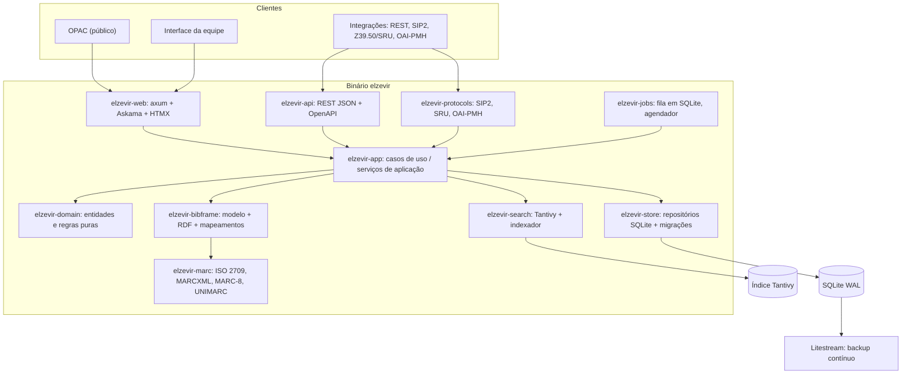
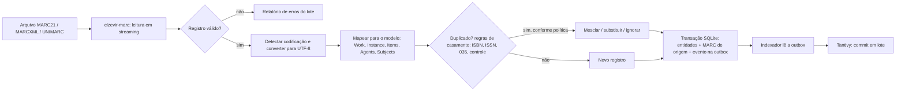
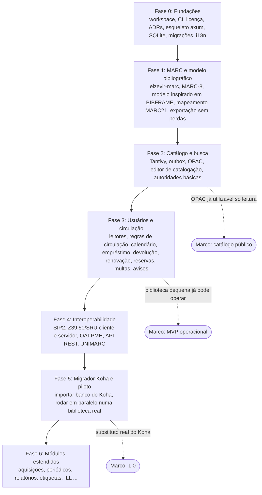
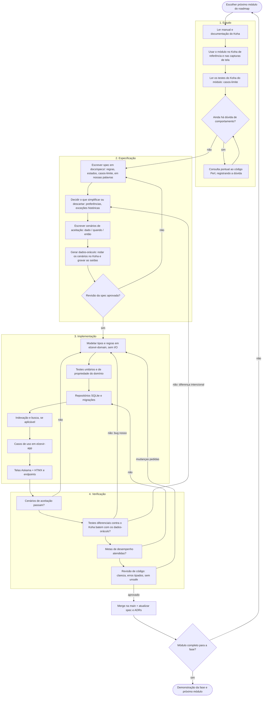

# Elzevir: avaliação da arquitetura e plano de reconstrução

> Status: proposta para discussão (fase conceitual, nada implementado ainda).
> Data: 2026-11-12.
> Escopo: avaliar a stack proposta, apontar riscos, sugerir ajustes pragmáticos e definir o fluxo operacional da reconstrução do Koha em Rust.

## 0. Resumo executivo

A stack escolhida (Rust, tokio, axum, Askama + HTMX, SQLite em WAL, Tantivy) é **boa e coerente** com o objetivo de um sistema rápido, simples de implantar e fácil de manter. Recomendo mantê-la quase integralmente.

Os riscos reais do projeto **não estão na stack**, e sim em quatro pontos:

1. **Licença.** **Decidido:** o Elzevir é **GPLv3** (GPL-3.0-or-later), a mesma licença do Koha. Assim não há conflito jurídico em estudar o código do Koha que está no repositório. O método de "reconstrução limpa" (§3) continua valendo, mas por qualidade técnica, não por exigência legal.
2. **BIBFRAME 2.0 como núcleo.** É uma ótima direção, mas BIBFRAME é um vocabulário RDF (grafo), e a conversão MARC → BIBFRAME → MARC **perde informação**. Proponho um modelo de domínio *tipado e relacional inspirado em BIBFRAME*, com o registro MARC de origem preservado para garantir exportação fiel (ver §2.5).
3. **Escopo.** O Koha tem 303 tabelas, ~935 preferências de sistema e ~110 grupos de endpoints REST. Reescrever tudo é um projeto de anos. É preciso um MVP fechado e fases bem definidas (ver §5).
4. **Ecossistema MARC em Rust é fino.** Não há crate madura para UNIMARC, e MARC-8 / ISO 5426 (codificações legadas) são armadilhas clássicas. Vamos precisar de uma crate própria `elzevir-marc`, com fuzzing e testes de ida e volta.

Também proponho três adições que não estavam no plano e que, na minha avaliação, decidem se o projeto será adotado: **um migrador Koha → Elzevir**, **testes diferenciais contra uma instância real do Koha** (o Koha vira um oráculo de comportamento) e **SIP2 + Z39.50/SRU** cedo no roadmap, porque bibliotecas reais dependem deles.

---

## 1. O que existe hoje no repositório

| Caminho | Conteúdo | Observação |
|---|---|---|
| `koha/` | Código-fonte do Koha 26.06.00.052 (Perl, templates TT, testes `.t`, API OpenAPI) | GPLv3. Ótima referência, mas ver §3 sobre licença. Será trocado pela versão estável mais recente (26.05.05) e movido para `reference/` (ver [04](04-decisoes.md)). |
| `Data/*.html` | Capturas de páginas da interface do Koha (staff) | Útil para mapear telas e fluxos. |
| `Data/kohastructure.sql` | Esquema do banco do Koha (303 `CREATE TABLE`) | Referência de domínio, não de modelagem a copiar. |
| `Data/mandatory/sysprefs.sql` | ~935 preferências de sistema | A maior fonte de complexidade acidental do Koha. |
| `Data/localization/` | Dados de localização | |

Recomendação: mover `koha/` e `Data/` para um repositório separado de referência (por exemplo `elzevir-reference`) ou para uma pasta `reference/` claramente fora do workspace Cargo. Isso reduz o tamanho do repositório (168 MB hoje), separa o que é "nosso" do que é "deles" e facilita a disciplina descrita em §3.

---

## 2. Avaliação da stack, componente por componente

Legenda: ✅ manter · ⚠️ manter com ajustes · ❌ trocar

### 2.1 Rust ✅

Escolha certa para o objetivo: desempenho previsível, binário único, sem GC, e um sistema de tipos que ajuda muito a modelar regras de circulação e catalogação (estados impossíveis viram tipos impossíveis).

Ajustes de disciplina, desde o primeiro commit:

- `thiserror` nas bibliotecas, `anyhow` só nos binários.
- `#![forbid(unsafe_code)]` em todas as crates de domínio.
- `clippy -D warnings`, `rustfmt`, `cargo-deny` (licenças e vulnerabilidades) e `cargo-machete` no CI.
- MSRV fixado e `Cargo.lock` versionado.

### 2.2 tokio + axum ✅

Padrão de fato do ecossistema, maduro e rápido. Pontos de atenção:

- **SQLite é síncrono.** Toda chamada ao banco deve rodar fora das threads do runtime (`spawn_blocking` ou uma thread dedicada). Ver §2.4.
- Usar `tower-http` para compressão, timeouts, limites de tamanho de corpo, tracing e cabeçalhos de segurança.
- Sessões com `tower-sessions` (store em SQLite), CSRF em todos os formulários HTMX.

### 2.3 Askama + HTMX ⚠️

Ótima combinação para um sistema majoritariamente de formulários e tabelas como o de uma biblioteca: renderização no servidor, templates checados em tempo de compilação, quase nenhum JavaScript, OPAC rápido e indexável por buscadores.

Ajustes:

- **Internacionalização.** Askama não tem i18n embutido. O Koha atende dezenas de idiomas. Proponho **Fluent** (`fluent-rs`) com uma função de template `t("chave")`, começando pelo inglês como idioma principal e depois o português do Brasil; os demais idiomas entram mais tarde (decidido, ver [04](04-decisoes.md)).
- **Telas ricas.** O editor de catalogação e o balcão de circulação precisam de interações mais densas (atalhos de teclado, leitura contínua de códigos de barras, edição de campos repetíveis). Para essas, aceitar "ilhas" pequenas de JavaScript (Web Components em JS puro ou Alpine.js), sem framework SPA.
- **Acessibilidade.** OPAC deve mirar WCAG 2.2 AA desde o início; é bem mais barato do que corrigir depois.
- Askama recompila a cada mudança de template. Para iteração rápida de UI, considerar `cargo-watch` / `bacon` e manter templates pequenos e componentizados.

### 2.4 SQLite em modo WAL ⚠️

Para uma biblioteca única ou uma rede pequena, SQLite é **mais rápido** que MySQL/PostgreSQL (sem rede, sem serialização) e drasticamente mais simples de operar. Uma biblioteca grande raramente passa de algumas dezenas de escritas por segundo, bem abaixo do que um único escritor SQLite suporta.

Limites que precisam ser aceitos conscientemente:

- **Um escritor por vez.** Resolver com arquitetura, não com sorte: um *pool de leitura* (N conexões) e **uma única conexão de escrita** atrás de uma fila (ator). Transações de escrita curtas, sempre `BEGIN IMMEDIATE`.
- **Um processo, uma máquina.** Não há réplica nativa nem escala horizontal. Para backup e recuperação contínuos, usar **Litestream** (replicação do WAL para S3/disco). Para consórcios grandes (dezenas de bibliotecas, milhões de itens, alta disponibilidade), o SQLite pode não bastar.
- PRAGMAs obrigatórios: `journal_mode=WAL`, `synchronous=NORMAL`, `foreign_keys=ON`, `busy_timeout`, `cache_size` e `mmap_size` ajustados; `PRAGMA optimize` periódico.

**Decisão de driver.** Recomendo **`rusqlite`** com uma camada fina própria, em vez de `sqlx`:

- controle total de PRAGMAs, transações e da conexão única de escrita;
- menos sobrecarga (o `sqlx` com SQLite já usa uma thread de trabalho por baixo);
- a perda da checagem de SQL em tempo de compilação é compensada por testes de repositório contra um banco real em memória.

**Portabilidade futura.** Não recomendo abstrair SQLite e PostgreSQL ao mesmo tempo agora (dobra o custo de testes). Recomendo, sim, regras que mantenham a porta aberta: SQL padrão, chaves e datas em formatos portáveis, todo acesso a dados atrás de *traits* de repositório por agregado.

**Dinheiro e datas.** Multas e taxas em inteiros de centavos (`i64`), nunca `f64`. Datas com **`jiff`** (fuso horário correto, essencial para cálculo de vencimento com calendário de feriados).

### 2.5 BIBFRAME 2.0 como núcleo interno ⚠️ (o ponto mais importante)

É uma escolha moderna e diferencial: separa Obra (Work), Manifestação/Instância (Instance) e Item, se alinha a dados ligados e coloca o Elzevir à frente do Koha, que ainda é MARC no núcleo. Mas há quatro armadilhas:

1. **BIBFRAME é um vocabulário RDF, não um esquema de banco.** Guardar triplas genéricas em SQLite (um "triple store" caseiro) tornaria consultas simples lentas e o código difícil de entender.
2. **A ida e volta MARC → BIBFRAME → MARC perde informação.** Nem os conversores oficiais da Library of Congress (`marc2bibframe2` e `bibframe2marc`) são sem perdas. Bibliotecas **precisam** exportar MARC fiel: catálogo coletivo, cópia de catalogação via Z39.50, envio para outros sistemas.
3. **FRBRização (agrupar instâncias numa mesma obra) é difícil.** Fazer isso automaticamente na importação gera erros silenciosos.
4. **UNIMARC tem muito menos ferramentas de conversão para BIBFRAME** que MARC21.

**Proposta: "BIBFRAME no modelo, MARC preservado na borda".**

- **Modelo de domínio tipado e relacional, inspirado em BIBFRAME 2.0.** Entidades Rust (`Work`, `Instance`, `Item`, `Agent`, `Concept/Subject`, `Contribution`, `Title`, `Identifier`, ...) persistidas em tabelas normais. As propriedades menos usadas ficam numa coluna JSON por entidade, para não explodir o número de tabelas.
- **BIBFRAME como serialização, não como armazenamento.** Exportar/importar JSON-LD, RDF/XML e Turtle a partir do modelo (crates `oxrdf`/`oxttl` ou `sophia`).
- **Registro de origem preservado.** Todo registro importado guarda o MARC original (binário ou MARC-in-JSON) e um "saco de campos não mapeados". Na exportação MARC, os campos que o modelo entende são regenerados a partir dele, e os demais vêm do registro preservado. Resultado: exportação sem perdas para tudo o que não foi editado.
- **Itens (exemplares) são relacionais e de primeira classe.** Circulação depende deles o tempo todo; não ficam dentro do grafo.
- **v1: uma Obra por Instância.** Sem fusão automática. Uma ferramenta de "fundir obras" vem depois, com revisão humana.
- **Mapeamentos como dados, não como código espalhado.** Tabelas de mapeamento MARC21 ↔ modelo e UNIMARC ↔ modelo, versionadas e testadas com exemplos reais. A especificação do `marc2bibframe2` da LC serve como referência de mapeamento (é um produto do governo dos EUA; confirmar a licença antes de reutilizar trechos).
- **Ordem:** MARC21 primeiro (mais ferramentas, mais dados de teste), UNIMARC depois.

### 2.6 MARC21 / MARCXML / UNIMARC ⚠️

- **Crate própria `elzevir-marc`.** O ecossistema Rust tem opções para MARC21 (`marc`, `marctk`, `marc-record`), mas nenhuma cobre UNIMARC, e o MARC é o coração da interoperabilidade. ISO 2709 é um formato simples; vale ter o controle. As crates existentes servem de comparação nos testes.
- **Codificações legadas:** MARC-8 (MARC21, posição 09 do líder em branco) e ISO 5426/6937 (UNIMARC antigo). Muitos acervos brasileiros têm registros antigos com essas codificações. Isso precisa entrar no MVP de importação.
- **Leitura tolerante, escrita estrita.** Registros reais vêm quebrados (comprimentos errados, diretórios inconsistentes). Importar com relatório de erros por registro, sem abortar o lote.
- **MARCXML** com `quick-xml` em modo streaming, para lotes de milhões de registros sem carregar tudo em memória.
- **Fuzzing** (`cargo-fuzz`) nos parsers desde o início.

### 2.7 Tantivy ✅

Escolha excelente: substitui Zebra e Elasticsearch do Koha com uma biblioteca embutida, sem serviço extra. Ajustes:

- **SQLite é a fonte da verdade; o índice é derivado e reconstruível.** Sincronizar com o padrão *transactional outbox*: cada escrita de catálogo grava, na mesma transação, um evento em `index_outbox`; um indexador em segundo plano consome a fila e confirma lotes no Tantivy. Nenhuma inconsistência se o processo cair no meio.
- **Análise de texto para português:** remoção de diacríticos (ASCII folding), stemmer de português, e um campo "exato" sem stemming para títulos e autores.
- **Facetas** (autor, assunto, tipo de material, idioma, ano, biblioteca, disponibilidade).
- **Ordenação por número de chamada** (CDD, CDU, LCC) com chaves de ordenação normalizadas, como faz o `ClassSortRoutine` do Koha.
- **Linguagem de consulta da equipe:** além da busca simples, uma sintaxe com prefixos de campo (`ti:`, `au:`, `su:`, `isbn:`) para catalogadores.
- Disponibilidade (emprestado / disponível) muda muito; manter fora do índice textual ou num campo rápido atualizado separadamente, para não reindexar o registro a cada empréstimo.

---

## 3. "Reconstrução limpa" a partir do Koha: método e licença

### 3.1 O método

A ideia está certa: **não traduzir Perl para Rust**. Traduzir carregaria junto 25 anos de decisões acidentais, e um tradutor (humano ou IA) lendo código legado tende a reproduzir bugs e "inventar" comportamento. O caminho robusto é:

1. **Especificar comportamento, não código.** Para cada módulo, escrever em nossas palavras o que o sistema faz: regras, estados, casos-limite, mensagens.
2. **Fontes de especificação, em ordem de preferência:** manual do Koha e documentação pública → uso da interface (as capturas em `Data/`) → testes do Koha (`reference/koha/t/`, ~850 arquivos `.t`, que descrevem casos-limite de forma explícita) → código Perl só para tirar dúvidas pontuais, nunca como base de implementação.
3. **O Koha como oráculo.** Subir um Koha real (por exemplo, `koha-testing-docker`) e rodar **testes diferenciais**: mesma entrada nos dois sistemas, comparar a saída (data de vencimento, multa calculada, posição na fila de reservas, MARC exportado). Isso substitui "achismo" por evidência e é a melhor defesa contra alucinação.
4. **Simplificar de propósito.** Cada preferência de sistema do Koha (~935) precisa justificar sua existência. A maioria vira um padrão sensato fixo, configuração tipada ou é descartada.

### 3.2 Licença: GPLv3 (decidido)

O Elzevir é licenciado sob **GPL-3.0-or-later**, a mesma do Koha ("versão 3 ou posterior"). O texto está em `LICENSE`, na raiz do repositório.

Consequências práticas:

- **Estudar o Koha é livre.** Ler o código, reaproveitar ideias, mapeamentos, textos de mensagens e até trechos não cria problema de licença. Quando algo vier diretamente do Koha, registrar a origem no commit ou na spec, por cortesia e rastreabilidade.
- **O método do §3.1 continua.** A regra "não traduzir Perl" é técnica: evita carregar decisões acidentais e reduz comportamento inventado.
- **Dependências:** crates MIT, Apache-2.0, BSD, MPL-2.0 e LGPL são compatíveis com GPLv3. O `cargo-deny` no CI deve barrar licenças incompatíveis, como Apache-1.1 e algumas licenças "source-available".
- **Uso como serviço:** a GPLv3 não obriga quem hospeda o Elzevir como serviço web a publicar modificações. Se isso importar no futuro, a AGPLv3 fecha essa brecha, e a migração da GPL-3.0-or-later para a AGPLv3 é permitida pela própria licença.
- **Cabeçalho:** cada arquivo-fonte leva um identificador SPDX curto: `// SPDX-License-Identifier: GPL-3.0-or-later`.

---

## 4. Arquitetura proposta

### 4.1 Forma geral: monólito modular, binário único

Um único executável `elzevir` serve OPAC, interface da equipe, API REST e tarefas em segundo plano, com um diretório de dados (`elzevir.db`, `index/`, `uploads/`). Instalação = copiar um binário e um arquivo de configuração. Escala vertical simples, backup simples.

Internamente, arquitetura hexagonal: o domínio não conhece SQLite, HTTP nem Tantivy.

### 4.2 Workspace Cargo

Começar com poucas crates e dividir quando doer. Sugestão inicial:

| Crate | Responsabilidade | Depende de |
|---|---|---|
| `elzevir-domain` | Entidades, objetos de valor, regras (circulação, multas, calendário). Puro, sem I/O. | nada |
| `elzevir-marc` | Leitura/escrita ISO 2709 e MARCXML, MARC-8, UNIMARC, validação. | nada |
| `elzevir-bibframe` | Modelo bibliográfico, mapeamentos MARC ↔ modelo, serialização RDF. | domain, marc |
| `elzevir-store` | Repositórios SQLite, migrações, ator de escrita, outbox. | domain |
| `elzevir-search` | Esquema Tantivy, analisadores pt/en, indexador, consultas e facetas. | domain |
| `elzevir-app` | Casos de uso (emprestar, devolver, importar lote, ...), transações, permissões. | todas acima |
| `elzevir-web` | Rotas axum, templates Askama, fragmentos HTMX, i18n. | app |
| `elzevir` (bin) | Configuração, inicialização, CLI (`import`, `reindex`, `migrate`, `admin`). | todas |

`elzevir-api`, `elzevir-protocols` e `elzevir-jobs` nascem quando as fases correspondentes chegarem.

### 4.3 Fluxo de dados de uma importação MARC

### 4.4 Outras decisões transversais

- **Autenticação:** senhas com Argon2id; sessões em SQLite; depois LDAP, OIDC/SAML (o Koha tem "identity providers").
- **Permissões:** RBAC simples (papéis × permissões × biblioteca), em vez das `userflags` em bitmask do Koha.
- **Tarefas em segundo plano:** fila persistida em SQLite (importações, avisos por e-mail, cálculo de multas noturno, reindexação). Sem Redis, sem RabbitMQ.
- **Avisos e comprovantes:** templates Askama/Fluent; envio SMTP com `lettre`; impressão de comprovantes em HTML.
- **Observabilidade:** `tracing` com logs estruturados, métricas Prometheus, endpoint de saúde.
- **API:** REST JSON versionada, OpenAPI gerado do código (`utoipa`).
- **Configuração:** arquivo TOML + variáveis de ambiente, tipados com `serde`. Preferências editáveis pela interface só quando há motivo real.

### 4.5 Metas de desempenho (propostas, a validar)

Definir números desde o começo para que "alta performance" seja verificável. Base de teste: 1 milhão de registros bibliográficos (os arquivos MARC abertos da Library of Congress servem) e 2 milhões de itens.

| Operação | Meta |
|---|---|
| Busca simples no OPAC, p95 | < 50 ms |
| Página de registro no OPAC, p95 | < 30 ms |
| Empréstimo / devolução no balcão, p95 | < 25 ms |
| Importação MARC21 | > 2.000 registros/s, com indexação |
| Reindexação completa | < 15 min para 1 milhão de registros |
| Memória em repouso | < 200 MB |

Medição com `criterion` (microbenchmarks) e um teste de carga (`oha` ou `k6`) no CI noturno.

---

## 5. Escopo e fases

### 5.1 O que fica fora da v1

Aquisições, periódicos (serials), ERM, empréstimo entre bibliotecas (ILL), reservas de curso, criador de etiquetas e de carteirinhas, PDV, clubes, recalls, agendamentos (bookings), preservação, Mana KB, relatórios em SQL livre. Todos podem voltar depois, cada um passando pelo mesmo fluxo do §6.

### 5.2 Fases

O **migrador Koha → Elzevir** (Fase 5) é o que transforma o Elzevir de "projeto interessante" em "alternativa real": nenhuma biblioteca troca de sistema se tiver que redigitar leitores, empréstimos em aberto e histórico. O esquema em `Data/kohastructure.sql` é a referência para esse migrador.

---

## 6. Fluxograma operacional da reconstrução

Este é o ciclo que cada módulo (circulação, reservas, multas, importação, ...) percorre. Ele garante que nada seja implementado a partir de suposição e que cada comportamento tenha evidência.

### Regras do fluxo

- **Nada de implementação sem spec aprovada.** A spec é o contrato; o código Perl não é.
- **Toda diferença em relação ao Koha é intencional e documentada** na spec (seção "Diferenças em relação ao Koha").
- **Uso de IA:** assistentes recebem a spec e os cenários como contexto, não o código Perl. Isso reduz drasticamente a chance de "tradução disfarçada" e de comportamento inventado.
- **Decisões de arquitetura viram ADRs** curtos em `docs/adr/` (contexto, decisão, consequências).

---

## 7. Decisões

Todas as decisões abaixo foram tomadas em 2026-11-12. O registro completo, com as demais decisões do planejamento, está em [04-decisoes.md](04-decisoes.md).

| # | Decisão | Resultado |
|---|---|---|
| 1 | Licença do Elzevir | **Decidido:** GPL-3.0-or-later (ver §3.2) |
| 2 | Porte-alvo da v1 | **Decidido:** biblioteca única e redes de bibliotecas (várias unidades numa instituição, até ~20 unidades e ~2 milhões de itens por base SQLite), mais várias instituições independentes por servidor |
| 3 | Onde fica o código do Koha | **Decidido:** `reference/` fora do workspace Cargo (pode virar um repositório separado mais tarde) |
| 4 | Formatos | **Decidido:** importação e exportação em MARC21, MARCXML e UNIMARC; a base interna é BIBFRAME 2.0. MARC21 primeiro, UNIMARC na Fase 4 |
| 5 | Profundidade do BIBFRAME | **Decidido:** modelo relacional inspirado em BIBFRAME 2.0 + registro MARC original preservado; sem triple store RDF |
| 6 | Driver SQLite | **Decidido:** `rusqlite` com ator de escrita única (thread dedicada) + pool de conexões de leitura |
| 7 | Idiomas da v1 | **Decidido:** inglês como idioma principal, depois português do Brasil; os demais idiomas depois, via Fluent |

## 8. Próximos passos sugeridos

1. ~~Fechar as decisões do §7.~~ Feito; ver [04-decisoes.md](04-decisoes.md).
2. Registrar cada decisão como ADR em `docs/adr/`.
3. Escrever a primeira spec pelo fluxo do §6: **`elzevir-marc` (leitura e escrita MARC21)**, que não depende de nada e destrava todo o resto.
4. Fase 0: criar o workspace Cargo, CI e o esqueleto do servidor.

O modo de implementação detalhado (regras de código, modelagem, transações, testes, primeiras tarefas e melhorias adicionais) está em [02-modo-de-implementacao.md](02-modo-de-implementacao.md).
