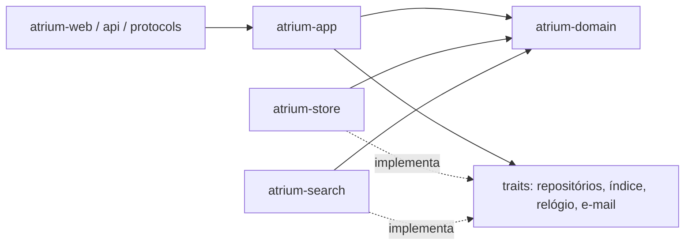
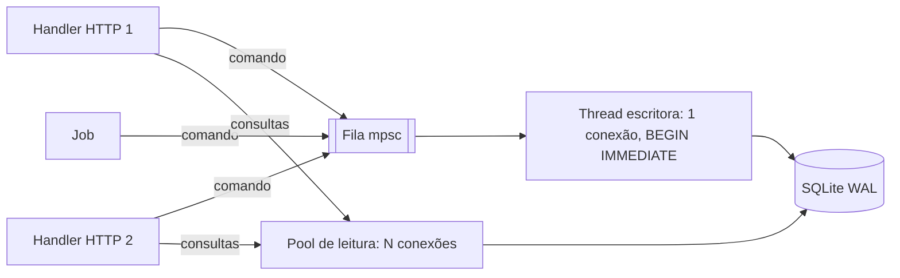

# Atrium: modo de implementação e melhorias propostas

> Status: proposta para discussão. Complementa [01-avaliacao-da-arquitetura.md](01-avaliacao-da-arquitetura.md).
> Data: 2026-11-12. Licença do projeto: GPL-3.0-or-later.

O documento 01 diz **o que** construir e **com quais peças**. Este diz **como** construir: regras de código, modelagem de dados, transações, testes, a sequência concreta das primeiras tarefas e as melhorias que proponho além do plano original.

---

## 1. Princípios de código

1. **O domínio é puro.** `atrium-domain` não faz I/O: não lê relógio, banco, rede nem disco. Recebe tudo como parâmetro (inclusive "agora" e o calendário) e devolve decisões. Isso torna regras como vencimento, multa e fila de reservas testáveis em microssegundos e sem mocks.
2. **Estados impossíveis não compilam.** Usar `enum`s e *newtypes* em vez de strings e `bool`s soltos: `ItemStatus::OnLoan { loan_id, due }` em vez de `onloan: Option<Date>` + `itemlost: i32` + `withdrawn: i32`, como no Koha.
3. **Erros são tipados e fazem parte da regra.** Um empréstimo negado devolve `Err(CheckoutRefusal::PatronDebtOverLimit { owed, limit })`, que a interface traduz em mensagem. Nada de `panic!` em caminho de requisição.
4. **Uma regra, um lugar.** Cada política (quantos empréstimos, quantas renovações, quanto de multa) é resolvida por uma única função de resolução de regras (§4). O Koha espalha isso por dezenas de lugares.
5. **Configuração tipada e pequena.** Cada nova opção precisa de uma justificativa escrita na spec. Meta: menos de 100 preferências na v1, contra ~935 no Koha.
6. **Sem *magic numbers* no banco.** Códigos de status, tipos e categorias são `TEXT` com `CHECK` ou tabelas de referência, nunca inteiros com significado implícito.

## 2. Camadas e regras de dependência



- `atrium-domain` não depende de nenhuma outra crate do Atrium.
- `atrium-app` conhece só os *traits* (portas). As implementações concretas (SQLite, Tantivy, SMTP) são injetadas no binário.
- A web nunca acessa o banco diretamente: sempre passa por um caso de uso.
- O CI verifica essas regras (por exemplo, com `cargo-deny` *bans* ou um teste simples sobre `cargo metadata`).

Exemplo do formato esperado de um caso de uso:

```rust
// atrium-app: emprestar um item
pub fn checkout(
    tx: &mut WriteTx,           // transação de escrita (SQLite)
    clock: &dyn Clock,
    req: CheckoutRequest,       // leitor, código de barras, biblioteca, operador
) -> Result<Loan, CheckoutError> {
    let patron = tx.patrons().get(req.patron_id)?;
    let item = tx.items().by_barcode(&req.barcode)?;
    let rules = tx.circ_rules().resolve(&RuleKey::for_checkout(&patron, &item, req.branch))?;
    let calendar = tx.calendars().for_branch(req.branch)?;

    // decisão pura, sem I/O
    let decision = domain::circulation::decide_checkout(&patron, &item, &rules, &calendar, clock.now())?;

    let loan = tx.loans().insert(decision.loan)?;
    tx.items().set_status(item.id, ItemStatus::OnLoan { loan_id: loan.id, due: loan.due })?;
    tx.audit().record(AuditEvent::checkout(&loan, req.operator))?;
    tx.outbox().availability_changed(item.instance_id)?;
    Ok(loan)
}
```

## 3. Modelagem de dados

### 3.1 Identificadores

- Chave primária interna: `INTEGER PRIMARY KEY` (rápida no SQLite).
- Identificador público estável: **UUIDv7** (ordenável por tempo) para registros bibliográficos, leitores e itens. Aparece em URLs, na API e nas exportações. Isso facilita migrações, fusões de bases e URIs de dados ligados (`https://biblioteca.exemplo/work/<uuid>`).
- Identificadores de negócio (código de barras, número do leitor, ISBN) são colunas próprias com índice único onde fizer sentido, nunca chave primária.

### 3.2 Multi-biblioteca desde o primeiro dia

Mesmo que o primeiro cliente seja uma única biblioteca, `branch_id` entra no modelo de itens, leitores, regras, calendário e permissões desde a Fase 0. Adicionar isso depois é uma das migrações mais caras que existem.

### 3.3 Auditoria e histórico

- Tabela `audit_log` (append-only): quem, quando, o quê, antes/depois (JSON). Equivalente ao `action_logs` do Koha, mas sempre gravada na mesma transação da mudança.
- Registros bibliográficos têm **versões**: cada edição guarda a versão anterior. Isso permite desfazer edições de catalogação e mostrar "quem mudou o quê".
- Exclusão de registro bibliográfico e de item é lógica (`deleted_at`), com expurgo programado. O Koha resolve isso com tabelas `deleted*` duplicadas; uma coluna é mais simples.

### 3.4 Migrações

- Migrações SQL numeradas e só para frente (`rusqlite_migration` ou uma implementação mínima própria), embutidas no binário.
- Na inicialização: backup automático do banco (`VACUUM INTO`) antes de aplicar migrações.
- Teste no CI: criar banco vazio, aplicar todas as migrações e comparar com o esquema esperado (snapshot).

### 3.5 Tipos no SQLite

- Tabelas `STRICT` (SQLite 3.37+) para que o banco rejeite tipos errados.
- Datas em ISO 8601 `TEXT` (com fuso quando for instante), dinheiro em `INTEGER` de centavos, booleanos em `INTEGER` com `CHECK (x IN (0,1))`.
- JSON (`TEXT` com `json_valid`) só para propriedades bibliográficas raras, nunca para campos consultados com frequência.

## 4. Motores de regras: circulação e calendário

São o coração funcional do Koha e onde mora a maioria dos bugs dele. Proposta:

**Resolução de regras de circulação.** As regras são definidas sobre a combinação biblioteca × categoria de leitor × tipo de item, com curingas (`*`). Atenção: no Koha 26.06 cada um dos 57 tipos de regra (`$RULE_KINDS` em `Koha/CirculationRules.pm`) declara o próprio escopo; `max_holds` usa só biblioteca × categoria, `holdallowed` só biblioteca × tipo. Esse inventário será extraído automaticamente (ver [03-estrategia-reconstrucao.md](03-estrategia-reconstrucao.md), §3.2). A resolução segue uma ordem de precedência explícita e documentada (da mais específica para a mais genérica), implementada em **uma única função pura**:

```text
(biblioteca, categoria, tipo)  >  (biblioteca, categoria, *)  >  (biblioteca, *, tipo)  >  (biblioteca, *, *)
  > (*, categoria, tipo)  >  (*, categoria, *)  >  (*, *, tipo)  >  (*, *, *)
```

A regra resolvida volta como uma struct completa (`ResolvedCircRules`), nunca campo a campo. A tela de administração mostra, para qualquer combinação, "qual regra vale e de onde ela veio".

**Calendário.** Função pura `next_open_day(calendar, date)` e `due_date(rules, calendar, now)`. Feriados fixos, feriados únicos, dias da semana fechados e exceções por biblioteca. Testes de propriedade (`proptest`): "o vencimento nunca cai num dia fechado" e "o vencimento nunca é antes de agora".

**Multas.** Função pura `fine_for(loan, rules, calendar, returned_at)`, em centavos, com teto e carência. O cálculo noturno (job) apenas chama a função e grava as diferenças.

**Fila de reservas.** Função pura que recebe as reservas pendentes e os itens disponíveis e devolve as alocações. É o ponto ideal para testes diferenciais contra o Koha.

## 5. Concorrência e transações



- **Escritas:** uma thread dedicada com a única conexão de escrita. Os handlers enviam uma *closure* de transação por um canal e aguardam a resposta (`oneshot`). Isso elimina `SQLITE_BUSY` entre escritores e serializa naturalmente.
- **Agrupamento:** a thread escritora pode juntar várias transações pequenas num único `COMMIT` em momentos de pico (*group commit*). Opcional, só se as medições mostrarem necessidade.
- **Leituras:** pool de conexões somente leitura (`r2d2`/`deadpool` ou um pool simples), usadas via `spawn_blocking`.
- **Regra de ouro:** nenhuma chamada de rede ou de disco lento (SMTP, Tantivy, HTTP externo) dentro de uma transação de escrita. Esses efeitos vão para a outbox ou para a fila de jobs.

## 6. Estratégia de testes

| Nível | Ferramenta | O que cobre | Quando roda |
|---|---|---|---|
| Unidade e propriedade | `cargo nextest`, `proptest` | Regras puras do domínio, parsers | Todo push |
| Snapshot | `insta` | Conversões MARC ↔ modelo, saída de RDF, HTML de fragmentos | Todo push |
| Repositório | SQLite em memória ou arquivo temporário | SQL, migrações, transações | Todo push |
| Aceitação | Cenários das specs (dado/quando/então) executados contra `atrium-app` | Comportamento de cada módulo | Todo push |
| Diferencial | Koha em container + dados-oráculo gravados | Equivalência com o Koha | Noturno, e ao mudar o módulo |
| Ponta a ponta | Playwright | Telas HTMX críticas: balcão de circulação, catalogação, busca do OPAC | Antes do merge na main |
| Fuzzing | `cargo-fuzz` | Parsers MARC, MARCXML, consultas de busca | Noturno |
| Desempenho | `criterion`, `oha` | Metas do §4.5 do documento 01 | Noturno, com alerta de regressão |

**Dados de teste:** um conjunto pequeno e versionado (algumas centenas de registros MARC escolhidos a dedo, incluindo casos patológicos) e um conjunto grande baixado sob demanda (registros abertos da Library of Congress) para desempenho.

## 7. Fluxo de trabalho do dia a dia

- **Branches curtos e PRs pequenos** (idealmente < 400 linhas). Um PR = uma spec ou parte dela.
- **Definition of Done** de um PR:
  1. spec atualizada (se mudou comportamento);
  2. testes do nível adequado passando;
  3. `clippy`, `fmt`, `deny` e `nextest` verdes;
  4. ADR escrito se tomou decisão de arquitetura;
  5. textos de interface em Fluent (sem string fixa no template);
  6. sem regressão nas metas de desempenho.
- **Ferramentas:** `just` (receitas de tarefas), `bacon` (recompilação contínua), `cargo nextest`, devcontainer com Rust estável fixado e um Koha de referência via `koha-testing-docker`.
- **Commits:** Conventional Commits em português (`feat(circ): ...`, `fix(marc): ...`), o que facilita gerar o changelog.

## 8. Primeiras tarefas concretas

### Fase 0: fundações (estimativa: 2 a 3 semanas de uma pessoa)

1. Workspace Cargo com as crates `atrium-domain`, `atrium-marc`, `atrium-store`, `atrium-app`, `atrium-web` e o binário `atrium`.
2. CI no GitHub Actions: `fmt`, `clippy -D warnings`, `nextest`, `cargo-deny`, verificação das regras de dependência.
3. ADRs 0001 a 0007 a partir das decisões do §7 do documento 01.
4. `atrium-store`: abertura do banco com os PRAGMAs, thread escritora, pool de leitura, migrações, backup antes de migrar.
5. `atrium-web`: axum com layout base Askama, HTMX, Fluent (inglês primeiro, depois pt-BR), sessões, CSRF, login com Argon2id, página "olá".
6. Configuração TOML tipada, logs estruturados com `tracing`, endpoint `/health`.
7. Inventário de telas: listar as capturas em `Data/` por módulo e marcar o que entra na v1 (vira o índice das specs).

### Fase 1: MARC e modelo bibliográfico (estimativa: 4 a 6 semanas)

1. Spec `marc-21-leitura-escrita` → `atrium-marc`: ISO 2709 tolerante, MARCXML em streaming, MARC-8 → UTF-8, ida e volta byte a byte nos casos válidos, fuzzing.
2. Spec `modelo-bibliografico` → `Work`, `Instance`, `Item`, `Agent`, `Subject`, `Identifier` no domínio, tabelas e versões.
3. Spec `mapeamento-marc21` → tabelas de mapeamento MARC21 ↔ modelo, com snapshots.
4. Exportação sem perdas (registro de origem preservado) com teste de propriedade: "importar e exportar sem editar devolve o mesmo MARC".
5. CLI `atrium import` e `atrium export`, com relatório de erros e meta de vazão.
6. Serialização BIBFRAME (JSON-LD e Turtle) a partir do modelo.

## 9. Melhorias adicionais propostas

Além do que já está no documento 01:

1. **LGPD desde o início.** Anonimização configurável do histórico de empréstimos (após N dias ou ao devolver), exportação dos dados do leitor a pedido, registro de base legal e consentimento, expurgo programado de leitores inativos. Para bibliotecas brasileiras isso é obrigatório e, no Koha, está espalhado.
2. **Typst para documentos impressos.** Comprovantes, etiquetas de lombada, carteirinhas e relatórios em PDF gerados com Typst (motor de composição escrito em Rust, embutível). Substitui os criadores de etiquetas e carteirinhas do Koha com muito menos código e resultado tipográfico melhor.
3. **Relatórios em SQL com segurança real.** Em vez do SQL livre do Koha (que já causou falhas de segurança), executar relatórios numa conexão somente leitura com o *authorizer* do SQLite, permitindo só `SELECT` em visões (*views*) públicas e escondendo colunas sensíveis (senhas, documentos). Relatórios prontos primeiro, SQL livre depois.
4. **Disponibilidade em tempo real no OPAC.** Status do exemplar (disponível, emprestado, reservado) lido do SQLite na renderização da página, e não do índice. Fica sempre correto, sem reindexar a cada empréstimo.
5. **Circulação offline (fase posterior).** O balcão como PWA, com fila local de empréstimos e devoluções sincronizada quando a rede voltar. Substitui o "offline circulation" do Koha, mas fica fora da v1.
6. **Extensões via WebAssembly (fase posterior).** Se plugins forem necessários, usar componentes WASM (`wasmtime`) com uma API pequena e isolada, em vez de carregar código arbitrário no processo, como o Koha faz com Perl.
7. **OpenTelemetry.** Traces de cada requisição até a transação SQLite e a consulta Tantivy, exportáveis para qualquer ferramenta. Ajuda a cumprir as metas de desempenho com evidência.
8. **Importação incremental e idempotente.** Toda importação tem um identificador de lote e pode ser repetida sem duplicar registros, e desfeita como um todo (o Koha tem "reverter lote"; aqui é nativo).
9. **Instalador de um comando.** Binário estático (musl) + `atrium init` que cria a configuração, o banco, o primeiro usuário administrador e um serviço systemd. Mais um pacote `.deb` e uma imagem de container. Facilidade de instalação é o maior diferencial possível frente ao Koha.
10. **Acessibilidade e mobile no OPAC.** Testes automáticos de acessibilidade (axe-core via Playwright) no CI. O OPAC deve funcionar bem em celular, que é como a maioria dos leitores acessa.

## 10. Riscos do modo de implementação e mitigações

| Risco | Mitigação |
|---|---|
| Specs viram burocracia e travam o ritmo | Spec curta (1 a 3 páginas), escrita junto com os cenários; revisão em 24 h |
| Mapeamento MARC ↔ modelo infinito | Mapear só o que a busca, a exibição e a circulação usam; o resto fica preservado no registro de origem |
| Testes diferenciais frágeis (Koha muda entre versões) | Fixar a versão do Koha de referência (26.05.05, a estável mais recente; ver doc 04) e gravar os dados-oráculo em arquivos versionados |
| SQLite insuficiente para um cliente grande | Metas de carga medidas desde a Fase 0; repositórios atrás de *traits* para permitir PostgreSQL no futuro |
| Escopo cresce por pedidos de paridade com o Koha | Lista de "fora da v1" (documento 01, §5.1) só muda por ADR |
