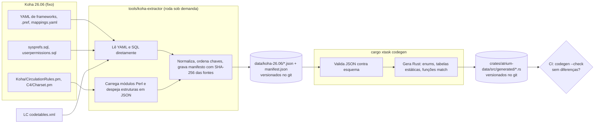
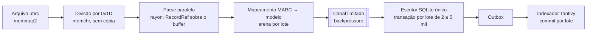
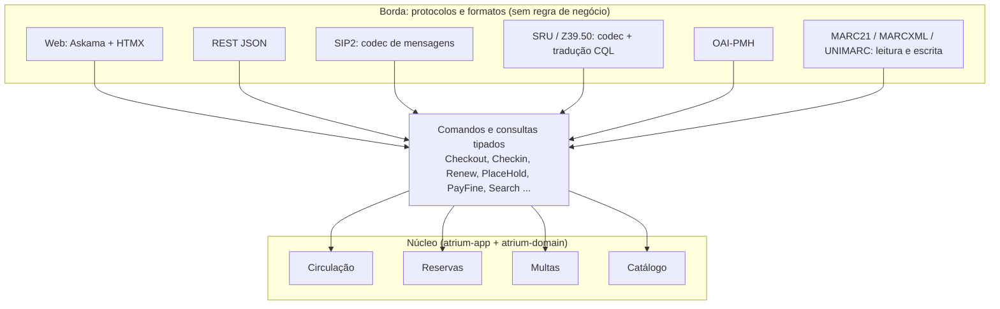
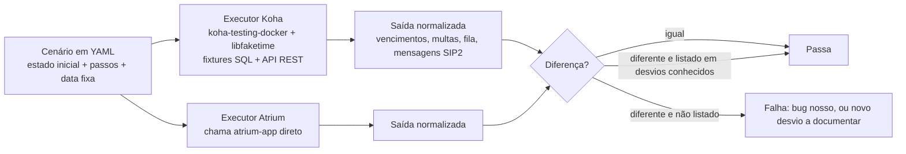
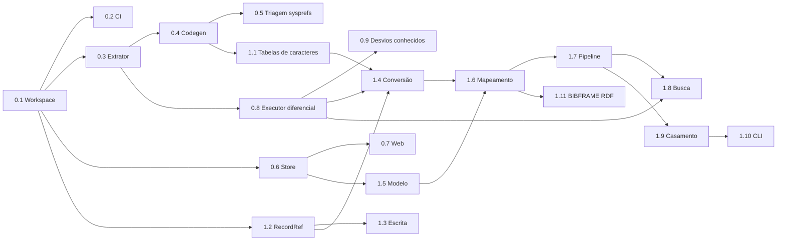

# Atrium: estratégia de reconstrução a partir de projetos reais em Rust

> Status: proposta para discussão. Complementa [01](01-avaliacao-da-arquitetura.md) e [02](02-modo-de-implementacao.md).
> Data: 2026-11-12. Referência funcional: Koha 26.06.00.052 (em `koha/`). Licença: GPL-3.0-or-later.

Este documento analisa como sete projetos reconstruíram (ou substituíram) sistemas grandes e legados em Rust e extrai padrões concretos para o Atrium. As afirmações sobre cada projeto foram verificadas nos repositórios públicos em 2026-11-12 (fontes no fim). Onde algo é inferência minha, está marcado.

## Sumário

- [0. O que cada projeto ensina](#0-o-que-cada-projeto-ensina)
- [1. Extração automatizada do legado (extractor + codegen)](#1-extração-automatizada-do-legado-extractor--codegen)
- [2. Zero-copy, arenas e interning na importação e na busca](#2-zero-copy-arenas-e-interning-na-importação-e-na-busca)
- [3. Protocolo separado do núcleo e testes diferenciais contra o oráculo](#3-protocolo-separado-do-núcleo-e-testes-diferenciais-contra-o-oráculo)
- [4. Mapeamento Koha → Atrium moderno](#4-mapeamento-koha--atrium-moderno)
- [5. Plano de execução enxuto: Fases 0 e 1](#5-plano-de-execução-enxuto-fases-0-e-1)
- [6. Lições dos projetos que pararam](#6-lições-dos-projetos-que-pararam)
- [Fontes](#fontes)

---

## 0. O que cada projeto ensina

| Projeto | O que substitui | Técnica central que nos interessa |
|---|---|---|
| **Valence** | Servidor Java do Minecraft (como framework) | Um mod Fabric (**extractor**) roda *dentro* do servidor original e exporta blocos, itens, pacotes etc. em JSON. Os JSON são **versionados no repositório** e um **build script gera o código Rust**. O processo de atualizar para uma nova versão do jogo é um roteiro de 7 passos documentado. Crate de protocolo separada do resto (`valence_protocol`). |
| **Pumpkin** | Servidor Java do Minecraft (completo) | Mesmo padrão de extractor, num projeto separado (`Pumpkin-MC/Extractor`), que exporta inclusive dados de **testes** do vanilla. A crate `pumpkin-data` tem `build.rs` próprio e **mais de 70 *features***, uma por grupo de dados gerados, para compilar só o necessário. Protocolo (`pumpkin-protocol`) separado do mundo (`pumpkin-world`). Plugins via host WebAssembly. Mesma licença que escolhemos (GPLv3). |
| **FerrumC** | Servidor Java do Minecraft | **Importa** os mundos no formato legado (Anvil) para um banco chave-valor próprio (LMDB via `heed`) em vez de operar sobre o formato antigo. Parsers próprios de NBT e Anvil. Meta explícita de **não ser uma cópia perfeita** do vanilla, e sim melhorar instalação, configuração e uso. |
| **Feather** | Servidor Java do Minecraft | Inativo. Implementou pouco do jogo, focou num ecossistema de plugins (WASM) antes do núcleo. Lição de escopo (§6). |
| **Ruff** | Flake8, Black, isort, pyupgrade e outros (Python) | **Reimplementa as regras** dos plugins em Rust mantendo os **mesmos códigos de regra** (E501, F401, ...). Testes de snapshot com `insta`. Ferramenta **`ruff-ecosystem`**: roda duas versões sobre projetos reais e compara as saídas. Documento público de **"desvios conhecidos" em relação ao Black**, e uma meta mensurável: em projetos grandes formatados com Black (Django, Zulip), mais de 99,9% das linhas ficam idênticas. |
| **uv** | pip, pip-tools, virtualenv | **Camada de compatibilidade na borda** (`uv pip install` "deve simplesmente funcionar") com um **modelo novo no núcleo** (lockfile, resolvedor PubGrub). Documento de **diferenças conhecidas** com relação ao pip. **Desserialização zero-copy com `rkyv`** no cache de metadados. |
| **Oxc** | Parsers e ferramentas JS (Babel, ESLint, Terser) | **Alocação em arena** (`oxc_allocator`, bump allocation): todo o AST vive numa arena com um único tempo de vida e é liberado de uma vez. **Testes de conformidade** contra as suítes do legado (Test262, Babel, TypeScript), rodados com `cargo coverage`. Strings compactas (`compact_str`), hash rápido (`rustc-hash`), `memchr` e validação UTF-8 SIMD. |

Os padrões que se repetem em todos os bem-sucedidos:

1. **O legado é fonte de dados, não de código.** Extrai-se o que é tabela; reescreve-se o que é lógica.
2. **Compatibilidade fica na borda; o núcleo é novo.**
3. **Paridade se mede, não se presume:** suíte do legado, corpus real e diferença automatizada.
4. **Desvios são intencionais e documentados.**

---

## 1. Extração automatizada do legado (extractor + codegen)

### 1.1 O que existe no Koha 26.06 e pode ser extraído

Inventário feito neste repositório:

| Fonte no Koha | Conteúdo | Tamanho | Uso no Atrium |
|---|---|---|---|
| `installer/data/mysql/en/marcflavour/marc21/mandatory/marc21_framework_DEFAULT.yml` | Estrutura MARC21 bibliográfica: tags, subcampos, rótulos, repetibilidade, obrigatoriedade, ligação com campos do Koha (`kohafield`) | 83.006 linhas | Tabela estática de validação MARC21 e rótulos do editor |
| `.../marc21/mandatory/authorities_normal_marc21.yml` | Estrutura MARC21 de autoridades | 36.275 linhas | Idem, autoridades |
| `.../unimarc/mandatory/unimarc_framework_DEFAULT.yml` e `authorities_normal_unimarc.yml` | Mesmo para UNIMARC | 69.399 linhas | Idem, UNIMARC |
| `.../marc21/optional/marc21_default_matching_rules.yml` | Regras de casamento de registros (ISBN, ISSN, 001, ...) | pequeno | Regras padrão de deduplicação na importação |
| `.../optional/marc21_relatorterms.yml` | Termos de relator | pequeno | Vocabulário de papéis (autor, ilustrador, ...) |
| `installer/data/mysql/mandatory/sysprefs.sql` | Valores padrão de ~935 preferências | 939 linhas | **Inventário** para triagem (não vira configuração diretamente, ver §1.4) |
| `koha-tmpl/.../admin/preferences/*.pref` (21 arquivos YAML) | Para 933 preferências: módulo, seção, tipo de controle, opções permitidas e descrição | 21 arquivos | Junta-se ao `sysprefs.sql` para formar o inventário tipado |
| `Koha/CirculationRules.pm`, `$RULE_KINDS` | Os 57 tipos de regra de circulação com seu **escopo** (biblioteca, categoria, tipo de item), se é monetária e se pode ficar em branco | 57 entradas | Gera o catálogo de regras e valida o modelo tipado de §4 do doc 02 |
| `admin/searchengine/elasticsearch/mappings.yaml` | Campos de busca: rótulo, tipo, faceta, ordenação, sugestão, e de quais tags/subcampos MARC21 e UNIMARC vêm | 156 campos bibliográficos + autoridades | Gera o esquema Tantivy e as funções de extração MARC → documento de busca |
| `C4/Charset.pm`, `%chars` | Tabela ISO 5426 → Unicode (UNIMARC legado) | 360 entradas | Gera a tabela de conversão ISO 5426 |
| `installer/data/mysql/en/mandatory/*.yml` | Tipos de débito e crédito, tipos de restrição, valores autorizados padrão, avisos de exemplo | vários | Dados iniciais (*seed*) |
| `installer/data/mysql/mandatory/userpermissions.sql`, `userflags.sql` | Permissões | pequeno | Inventário para o RBAC |
| `api/v1/swagger/` | OpenAPI da API REST (110 caminhos, 137 definições) | — | Referência de nomes de campos para uma eventual camada de compatibilidade |
| `t/db_dependent/Circulation/*.t`, `Holds*`, `HoldsQueue*` | Casos de teste de vencimento, multas, limites, reservas | dezenas de arquivos | Fonte dos cenários de conformidade (§3.4) |

Fora do Koha:

| Fonte | Conteúdo | Observação |
|---|---|---|
| Library of Congress, `codetables.xml` | Tabelas oficiais MARC-8 ↔ Unicode | O Koha usa o módulo CPAN `MARC::Charset`, que não está no repositório. A tabela da LC é a fonte primária. |

Como o Atrium é GPL-3.0-or-later e esses arquivos do Koha são GPL-3.0-or-later, **extrair e redistribuir os dados é permitido**. Basta manter o aviso de origem nos arquivos gerados.

### 1.2 O pipeline: extractor → JSON versionado → codegen

Mesmo desenho do Valence e do Pumpkin, adaptado:



Decisões e por quê:

1. **Extrator separado do build**, como o mod do Valence e o projeto `Extractor` do Pumpkin. Ele roda só quando mudamos de versão do Koha e não entra na compilação normal.
   - Arquivos declarativos (YAML, SQL, XML) são lidos diretamente.
   - Estruturas que só existem em código Perl (`$RULE_KINDS`, `%chars`) são despejadas **executando o próprio Perl** com um script de poucas linhas (`perl -I koha -MKoha::CirculationRules -MJSON::PP -e '...'`). Para módulos com muitas dependências, o script roda dentro do `koha-testing-docker`. Isso é mais confiável do que interpretar o Perl com expressões regulares.
2. **JSON intermediário versionado no git**, como no Valence. Revisão de PR mostra exatamente o que mudou entre versões do Koha, e quem compila o Atrium não precisa ter o Koha.
3. **Manifesto de procedência** (`manifest.json`): versão do Koha, caminho e SHA-256 de cada arquivo-fonte, data da extração. Garante rastreabilidade.
4. **Codegen por `cargo xtask`, com o Rust gerado também versionado**, em vez de `build.rs`. Aqui me afasto do Valence e do Pumpkin, de propósito:
   - os frameworks MARC somam ~190 mil linhas de YAML; gerar isso a cada build num `build.rs` deixa a compilação mais lenta (o Pumpkin precisou ajustar `codegen-units` só para a `pumpkin-data`);
   - o código gerado fica legível no PR e navegável no editor;
   - o CI roda `cargo xtask codegen --check` e falha se o gerado estiver desatualizado.

   O `build.rs` continua sendo a escolha certa para casos pequenos e locais (por exemplo, embutir a versão do git no binário).
5. **Uma crate `atrium-data` com *features* por grupo**, como a `pumpkin-data`: `marc21-bib`, `marc21-auth`, `unimarc-bib`, `unimarc-auth`, `marc8`, `iso5426`, `search-fields`, `circ-rule-kinds`. Quem precisa só de MARC21 não compila UNIMARC.

### 1.3 O que o código gerado parece

Exemplo do formato (ilustrativo):

```rust
// @generated por `cargo xtask codegen` a partir de data/koha-26.06/marc21_bib.json
// Fonte: koha/installer/data/mysql/en/marcflavour/marc21/mandatory/marc21_framework_DEFAULT.yml
// SPDX-License-Identifier: GPL-3.0-or-later

pub struct TagDef {
    pub tag: Tag,                       // newtype sobre [u8; 3]
    pub label: &'static str,
    pub repeatable: bool,
    pub mandatory: bool,
    pub subfields: &'static [SubfieldDef],
}

pub static MARC21_BIB_TAGS: &[TagDef] = &[
    TagDef { tag: Tag(*b"020"), label: "INTERNATIONAL STANDARD BOOK NUMBER", repeatable: true, mandatory: false, subfields: &SF_020 },
    // ...
];

/// Busca por tag gerada como `match`: o compilador transforma em tabela de saltos, sem hash em tempo de execução.
pub fn marc21_bib_tag(tag: Tag) -> Option<&'static TagDef> {
    match &tag.0 {
        b"020" => Some(&MARC21_BIB_TAGS[0]),
        // ...
        _ => None,
    }
}
```

O mesmo vale para MARC-8 e ISO 5426: tabelas `static` ordenadas, com busca binária ou `match` gerado, sem nada alocado em tempo de execução.

Para a busca, o codegen gera a partir de `mappings.yaml`:

- o `tantivy::schema::Schema` com os 156 campos (tipo, armazenado ou não, faceta, ordenação);
- uma função `fn index_fields(rec: &RecordRef) -> SearchDoc` com as regras "tag + subcampos" de cada campo, compiladas em código, em vez de interpretadas registro a registro.

### 1.4 O que **não** deve ser gerado automaticamente

- **Preferências de sistema.** Gerar 935 opções em Rust só transferiria a dívida do Koha. O extrator produz um **inventário** (`sysprefs_inventory.json`: nome, módulo, tipo, opções, padrão, descrição). A partir dele, uma planilha de triagem decide o destino de cada uma: *virar configuração tipada*, *virar comportamento fixo*, *virar regra por unidade* ou *descartar*. O mesmo inventário alimenta o **migrador Koha → Atrium**, que precisa saber ler as preferências de uma instalação existente.
- **Lógica de negócio.** Cálculo de vencimento, multa e fila de reservas são reescritos a partir de specs (doc 01, §6). O extrator só fornece os *dados* que essa lógica consulta.
- **Textos de interface do Koha.** Os rótulos dos frameworks MARC são úteis no editor de catalogação. As mensagens de tela são escritas de novo, em Fluent, em pt-BR.

---

## 2. Zero-copy, arenas e interning na importação e na busca

Inspirado em Oxc (arena), Ruff (`compact_str`, `rustc-hash`, `memchr`) e uv (`rkyv`). Regra geral: **medir antes de otimizar**. Cada técnica abaixo só entra quando os benchmarks da Fase 1 mostrarem o custo.

### 2.1 Pipeline de importação



1. **Arquivo mapeado em memória (`memmap2`).** O sistema operacional pagina o arquivo; não há leitura para buffers intermediários.
2. **Divisão de registros com `memchr`** pelo terminador ISO 2709 (`0x1D`). Cada registro é um `&[u8]` dentro do mapa. Para MARCXML, `quick-xml` em modo streaming, que entrega fatias do buffer sempre que não há entidades a decodificar.
3. **`RecordRef<'a>` zero-copy**, no estilo dos *spans* do Oxc:

   ```rust
   pub struct RecordRef<'a> {
       raw: &'a [u8],               // o registro inteiro, sem cópia
       leader: &'a [u8; 24],
       dir: &'a [u8],               // diretório: entradas de 12 bytes
   }
   pub struct FieldRef<'a> {
       tag: Tag,                    // [u8; 3], sem String
       data: &'a [u8],              // fatia do registro
   }
   impl<'a> FieldRef<'a> {
       pub fn subfields(&self) -> impl Iterator<Item = (u8, &'a [u8])> { /* split por 0x1F */ }
   }
   ```

   Nada é alocado para ler um registro. Texto só é decodificado quando necessário, e devolve `Cow<'a, str>`: emprestado quando o registro já é UTF-8 válido (validação com `simdutf8`, como no Oxc), e alocado só quando precisa converter MARC-8 ou ISO 5426.
4. **Paralelismo por registro (`rayon`).** Registros são independentes; parse e mapeamento escalam com os núcleos. A escrita continua serializada no escritor único do SQLite (doc 02, §5), alimentada por um canal limitado: se o banco atrasar, o parse espera, e a memória não cresce.
5. **Arena por lote (`bumpalo`), como o `oxc_allocator`.** As estruturas intermediárias do mapeamento (listas de contribuições, assuntos, títulos) de um lote de registros vivem numa arena, que é **zerada de uma vez** ao fim do lote. Elimina milhões de `malloc`/`free` por importação. As arenas são reaproveitadas entre lotes (o Oxc tem um `AllocatorPool` com essa função).
6. **O registro de origem preservado** (doc 01, §2.5) é gravado como os próprios bytes ISO 2709 numa coluna `BLOB`. Relê-lo é zero-copy com o mesmo `RecordRef`. Isso cumpre o papel que o `rkyv` cumpre no uv (ler estruturas sem desserializar) sem adicionar outro formato.

### 2.2 Interning e tipos compactos

- **Tags e códigos de subcampo** nunca são `String`: `Tag([u8; 3])` e `u8`. Comparação de tag vira comparação de 3 bytes.
- **Valores muito repetidos** (códigos de idioma, de país, termos de relator, tipo de material, códigos de biblioteca, categorias, tipos de item) são internados numa tabela de símbolos (`lasso` ou um `HashMap<Box<str>, u32>` próprio com `rustc-hash`). No domínio viram `SymbolId(u32)`, de 4 bytes. Os vocabulários fixos vêm do codegen (§1) e nem passam pela tabela: viram `enum`.
- **Cabeçalhos de assunto e nomes** (alto índice de repetição em acervos reais) são internados *durante o lote* e resolvidos para IDs de entidade (Agent, Subject) com uma única consulta ao banco por lote, não por registro.
- **Strings curtas** (números de chamada, códigos de barras, ISBN) em `compact_str` (até 24 bytes sem alocação, a mesma crate usada por Ruff e Oxc). Listas pequenas em `smallvec`.
- **Hash rápido** (`rustc-hash`) em todos os mapas internos sem exposição a entrada externa. Mapas alimentados por usuários continuam com o hasher padrão, resistente a ataques de colisão.

### 2.3 Banco durante a importação

- `prepare_cached` em todas as inserções; transações de 2 a 5 mil registros.
- **Modo carga inicial** (só para a migração do Koha, com o sistema fora do ar): criar índices secundários *depois* da carga e reconstruir o índice Tantivy de uma vez no final. Não usar `synchronous=OFF` nem desligar o WAL: o ganho não compensa o risco de corromper o banco.

### 2.4 Busca

- **Tantivy já é zero-copy** (índice mapeado em memória). O cuidado está ao redor dele:
  - um `IndexReader` compartilhado e recarregado após cada commit, nunca aberto por requisição;
  - **campos rápidos (*fast fields*) e armazenados** para título, autor, ano e capa na lista de resultados, para não ir ao SQLite para cada acerto;
  - **disponibilidade** dos exemplares buscada no SQLite numa **única** consulta por página (`WHERE instance_id IN (...)`), nunca uma por resultado.
- **Analisadores gerados** (§1.3): o mapeamento de campos é código compilado, não interpretação de configuração por documento.
- **Consulta da equipe** (`ti:`, `au:`, `isbn:`): parser pequeno sobre `&str`, produzindo uma AST com fatias da própria consulta. Consultas são curtas e não precisam de arena.

### 2.5 Como provar que funcionou

- **Contagem de alocações por registro** como métrica do CI, com `dhat` ou um alocador contador nos benchmarks (o Oxc tem um modo `track_allocations` com esse propósito). Meta inicial: < 5 alocações por registro MARC21 válido no caminho de leitura e mapeamento.
- `criterion` para MB/s de parse e registros/s de importação, com alerta de regressão.
- Pico de memória durante a importação de 1 milhão de registros, que deve ficar **constante** (não proporcional ao tamanho do arquivo).

---

## 3. Protocolo separado do núcleo e testes diferenciais contra o oráculo

### 3.1 Como os servidores Minecraft em Rust fazem

- **Protocolo é uma crate isolada** (`valence_protocol`, `pumpkin-protocol`): codificação e decodificação de pacotes, e nada de regra do jogo. As definições de pacotes vêm do extractor.
- **O núcleo tem arquitetura própria**: Valence e FerrumC usam ECS; o Java original não. Paridade é exigida no que o cliente *observa* (pacotes, estados do mundo), não na estrutura interna.
- **Armazenamento próprio com importação do formato legado**: o FerrumC importa mundos Anvil para LMDB. O formato legado é tratado na entrada, não carregado como modelo interno.
- **Uma versão-alvo por vez**: o Valence declara que não pretende suportar várias versões do jogo simultaneamente e documenta o processo de atualização para a próxima.

### 3.2 Aplicação no Atrium: adaptadores finos sobre um único núcleo



Regras:

1. **Cada protocolo só traduz.** O SIP2 recebe `11` (Checkout), decodifica para `Checkout { patron, item, branch }`, chama o mesmo caso de uso que o balcão web usa e codifica a resposta `12`. Não existe "lógica de empréstimo do SIP2". No Koha, o `C4/SIP` tem lógica própria em vários pontos; isso é exatamente o que evitamos.
2. **Mensagens de protocolo são dados gerados.** Os campos fixos e variáveis do SIP2 (códigos de 2 letras, tamanhos) e os conjuntos de atributos do Z39.50 entram no codegen (§1) a partir da especificação, como os pacotes no Pumpkin e no Valence.
3. **Erros do núcleo têm um mapeamento por protocolo.** `CheckoutRefusal::PatronDebtOverLimit` vira uma mensagem HTML na web, um JSON 409 na REST e um `12` com `ok=0` e campo `AF` no SIP2. A tabela de mapeamento é explícita e testada.
4. **Formatos legados só na entrada e na saída**, como o FerrumC com o Anvil. MARC não é o modelo interno (doc 01, §2.5).

### 3.3 Testes diferenciais: o Koha como oráculo

Combina o `ruff-ecosystem` (comparar duas implementações sobre dados reais) com a conformidade do Oxc (rodar a suíte do legado e acompanhar a taxa de aprovação).



Detalhes práticos:

- **Tempo determinístico.** Vencimentos e multas dependem de "hoje". O Koha usa o relógio do sistema; o executor fixa a data com `libfaketime` no container. No Atrium, o relógio já é um parâmetro do domínio (doc 02, §1).
- **Saídas normalizadas.** Comparar o que importa (datas, valores em centavos, ordem da fila, códigos de status), não HTML nem IDs internos.
- **Oráculo gravado.** As saídas do Koha ficam em arquivos versionados (`conformance/koha-26.06/*.json`). O CI normal compara contra os arquivos, sem subir o Koha. Um job noturno, ou manual ao mudar de versão, regrava os arquivos rodando o Koha de verdade.
- **Gravação e reprodução de protocolo.** O Valence tem um *packet inspector* (um proxy que registra o tráfego entre cliente e servidor). Para o Atrium: um **proxy SIP2** colocado entre um terminal de autoatendimento e o Koha grava sessões reais; as sessões são reproduzidas contra o Atrium e as respostas comparadas campo a campo. O mesmo vale para Z39.50/SRU, usando um cliente padrão (`yaz-client`) contra os dois servidores.
- **Corpus real** (o "ecossistema" do Ruff): bases MARC de bibliotecas parceiras (anonimizadas) e os registros abertos da Library of Congress. A importação e a exportação de todo o corpus rodam em cada release, comparando com a versão anterior do próprio Atrium.

### 3.4 Conformidade a partir dos testes do Koha

O Oxc roda as suítes Test262, Babel e TypeScript e acompanha a porcentagem aprovada. Para o Atrium:

1. Ler os testes de `t/db_dependent/Circulation/` (por exemplo `CalcDateDue.t`, `CalcFine.t`, `TooMany.t`, `Returns.t`), `Holds*.t` e `HoldsQueue*.t`.
2. Reescrever cada caso relevante como **cenário de dados** (YAML), sem código Perl.
3. Rodar todos e gravar um **snapshot da taxa de conformidade** (`conformance/summary.snap`, com `insta`). Toda PR que muda essa taxa precisa mostrar a diferença.

### 3.5 Desvios conhecidos e nomes do legado

- **`docs/desvios-conhecidos.md`**, nos moldes do documento do Ruff sobre o Black e do uv sobre o pip: cada diferença intencional em relação ao Koha, com justificativa. O executor diferencial lê essa lista.
- **Nomes que os bibliotecários conhecem são mantidos na borda**, como o Ruff manteve os códigos das regras do Flake8: códigos de aviso (`ODUE`, `CHECKOUT`, `HOLD`), nomes dos tipos de regra de circulação, códigos de categoria de leitor. Internamente, os tipos Rust podem ter nomes melhores; o migrador e a interface fazem a ponte.
- **Uma versão-alvo por vez**: a paridade é com o **Koha 26.06**. Mudar para 26.11 é um processo documentado, como o do Valence: rodar o extrator, revisar o diff do JSON, regravar o oráculo, avaliar as diferenças.

---

## 4. Mapeamento Koha → Atrium moderno

| Mecanismo no Koha 26.06 | Problema | Substituto no Atrium | Fase |
|---|---|---|---|
| ~935 `systempreferences` globais, chave/valor em texto | Sem tipo, sem escopo (quase tudo é global), validação espalhada no código | **Configuração tipada em camadas**: `global → biblioteca → (categoria / tipo de item quando fizer sentido)`. Structs `serde` com valores padrão. A triagem parte do inventário extraído (§1.4). Meta: < 100 opções na v1 | 0 |
| `circulation_rules` com 57 tipos, cada um com escopo próprio, valores em texto | Valores sem tipo, resolução repetida em vários lugares | **Catálogo de regras gerado** (§1) + structs tipadas por escopo (`LoanRules`, `HoldRules`, `FeeRules`) + **uma** função de resolução com explicação de origem | 3 |
| Zebra / Elasticsearch (serviço externo) | Mais um serviço para instalar, indexação lenta, configuração difícil | **Tantivy embutido**, esquema gerado de `mappings.yaml`, outbox transacional | 2 |
| Templates Template Toolkit + jQuery + DataTables | Telas pesadas, muita lógica no cliente | **Askama + HTMX**, fragmentos renderizados no servidor, ilhas mínimas de JS | 0 em diante |
| Avisos e comprovantes editáveis em Template Toolkit (e na sintaxe antiga `<<campo>>`) | Podem ser editados pela biblioteca em tempo de execução | **MiniJinja** em modo restrito (*sandbox*): o Askama compila os templates e não serve para texto editável pelo usuário. Variáveis expostas por uma lista explícita | 3 |
| PDFs com `PDF::Reuse` / `PDF::API2` (etiquetas, carteirinhas, pedidos) | Layout manual, coordenadas fixas | **Typst** embutido: modelos de etiqueta, carteirinha e comprovante em arquivos `.typ` | 4 em diante |
| `background_jobs` + RabbitMQ (STOMP) | Serviço externo | **Fila em SQLite** com *workers* tokio | 1 |
| ~56 scripts em `misc/cronjobs` + crontab | Agendamento externo, sem visibilidade | **Agendador interno** (multas noturnas, avisos, anonimização LGPD, expurgos), com tela de status | 3 |
| `userflags` (bitmask) + `user_permissions` | Difícil de entender e auditar | **RBAC**: papéis × permissões × biblioteca. Inventário extraído de `userpermissions.sql` | 0 |
| `authorised_values` genéricos | Vocabulários fixos e configuráveis misturados | **Enums gerados** para os fixos; **vocabulários configuráveis** só onde a biblioteca realmente personaliza | 1 |
| Frameworks MARC por biblioteca (tela de configuração campo a campo) | O núcleo é MARC, a interface reflete MARC cru | **Tabelas MARC geradas** para validar entrada e saída; **perfis de editor** sobre o modelo inspirado em BIBFRAME | 1 a 2 |
| `action_logs` opcional por módulo | Auditoria desligada por padrão | **`audit_log` sempre ligado**, na mesma transação (doc 02, §3.3) | 0 |
| Tabelas `deleted*` duplicadas | Esquema duplicado | Coluna `deleted_at` + expurgo programado | 1 |
| Plack/Starman + Memcached | Vários processos e um cache externo | **axum** num processo só + cache em memória (`moka`) onde houver medição que justifique | 0 |
| DBIx::Class + MySQL/MariaDB | ORM pesado, servidor de banco separado | **rusqlite** + repositórios + SQLite WAL | 0 |
| Relatórios em SQL livre | Risco de segurança | Relatórios prontos + SQL só leitura com *authorizer* do SQLite (doc 02, §9) | 5 |
| Plugins Perl carregados no processo | Código arbitrário com acesso total | **WebAssembly com sandbox** depois da v1 (o mesmo caminho do Pumpkin e do Feather) | 6 |
| Servidor SIP2 em `C4/SIP` com lógica própria | Regras duplicadas fora da circulação | **Codec SIP2** sobre os mesmos casos de uso (§3.2) | 4 |
| Z39.50/SRU via Zebra (yaz) | Depende do Zebra | **SRU nativo em axum** primeiro; **Z39.50** servidor depois, sobre o mesmo núcleo de busca | 4 |
| Conversão de codificação com `MARC::Charset` e `C4/Charset.pm` | Executada registro a registro em Perl | **Tabelas MARC-8 e ISO 5426 geradas** e conversão zero-copy quando já for UTF-8 (§2.1) | 1 |

---

## 5. Plano de execução enxuto: Fases 0 e 1

Cada tarefa indica a técnica aplicada e o critério objetivo de pronto.

### Fase 0: fundações

| # | Tarefa | Técnica | Pronto quando |
|---|---|---|---|
| 0.1 | Workspace Cargo (`atrium-domain`, `atrium-data`, `atrium-marc`, `atrium-store`, `atrium-app`, `atrium-web`, `atrium`, `xtask`) | Protocolo separado do núcleo (§3.2) | `cargo build` e regras de dependência verificadas no CI |
| 0.2 | CI: `fmt`, `clippy -D warnings`, `nextest`, `cargo-deny`, `xtask codegen --check` | Codegen versionado (§1.2) | CI verde na main |
| 0.3 | `tools/koha-extractor`, primeira versão: frameworks MARC21 bib/aut, `mappings.yaml`, `sysprefs.sql` + `.pref`, `$RULE_KINDS`, `userpermissions.sql`, `manifest.json` | Extractor (§1.2) | `data/koha-26.06/*.json` versionado e reproduzível (rodar duas vezes gera o mesmo arquivo) |
| 0.4 | `cargo xtask codegen` gerando `atrium-data` com *features* | Codegen (§1.3) | Tabelas MARC21 e catálogo de regras acessíveis em Rust; teste de que todo `kohafield` mapeado existe |
| 0.5 | Planilha de triagem de preferências a partir do inventário | §1.4 | Cada uma das ~935 preferências com destino decidido e ADR com a lista da v1 |
| 0.6 | `atrium-store`: PRAGMAs, escritor único, pool de leitura, migrações, auditoria | Doc 02, §3 e §5 | Teste de carga de escrita concorrente sem `SQLITE_BUSY` |
| 0.7 | `atrium-web`: axum, Askama, HTMX, Fluent pt-BR/en, login Argon2id, RBAC inicial | §4 | Login e página inicial funcionando, com testes Playwright |
| 0.8 | Esqueleto do executor diferencial: `koha-testing-docker` + `libfaketime` + formato YAML de cenário + um cenário trivial | §3.3 | Um cenário rodando nos dois lados e comparado no CI noturno |
| 0.9 | `docs/desvios-conhecidos.md` vazio com formato definido | §3.5 | Arquivo lido pelo executor diferencial |

### Fase 1: MARC e modelo bibliográfico

| # | Tarefa | Técnica | Pronto quando |
|---|---|---|---|
| 1.1 | Extrator: LC `codetables.xml` (MARC-8) e `%chars` de `C4/Charset.pm` (ISO 5426); frameworks UNIMARC | Extractor + codegen | Tabelas geradas; teste de ida e volta caractere a caractere sobre a tabela inteira |
| 1.2 | `atrium-marc`: `RecordRef`/`FieldRef` zero-copy, divisão com `memchr`, `memmap2`, validação `simdutf8` | §2.1 | Leitura de 1 milhão de registros com memória constante; fuzzing 1 hora sem falhas |
| 1.3 | Escrita ISO 2709 e MARCXML (streaming `quick-xml`) | — | Ida e volta byte a byte em registros válidos (teste de propriedade) |
| 1.4 | Conversão MARC-8 e ISO 5426 → UTF-8 com `Cow` | §2.1 | Corpus de teste com registros MARC-8 reais convertidos igual ao Koha (comparação diferencial) |
| 1.5 | Modelo inspirado em BIBFRAME no domínio + tabelas + versões | Doc 01, §2.5 | Migrações e repositórios testados |
| 1.6 | Mapeamento MARC21 → modelo, com tabelas geradas para validação e interning de vocabulários | §1.3 e §2.2 | Snapshots `insta` de 200 registros escolhidos; exportação sem edição devolve o MARC original |
| 1.7 | Pipeline de importação: `rayon` + arena por lote + canal limitado + escritor único + outbox | §2.1 e §2.3 | > 2.000 registros/s com indexação; < 5 alocações por registro na leitura e no mapeamento |
| 1.8 | Esquema Tantivy e extração de campos gerados de `mappings.yaml` | §1.3 e §2.4 | Busca por título/autor/ISBN/assunto sobre o corpus; comparação de resultados com o Koha em 50 consultas de referência |
| 1.9 | Regras de casamento padrão (de `marc21_default_matching_rules.yml`) | Extractor | Reimportar o mesmo arquivo não duplica registros |
| 1.10 | CLI `atrium import` / `atrium export` com relatório de erros por registro | — | Importação do corpus real da LC e de uma base Koha exportada |
| 1.11 | Serialização BIBFRAME (JSON-LD e Turtle) | — | Validação dos arquivos gerados num parser RDF independente |

### Ordem e dependências



A trilha crítica é **extrator → codegen → tabelas de caracteres → conversão → mapeamento → pipeline → busca**. Começar o extrator (0.3) em paralelo com o workspace é o que mais encurta o caminho.

---

## 6. Lições dos projetos que pararam

Três dos quatro servidores Minecraft analisados estão parados ou em estágio inicial: o Feather está inativo (o README recomenda contribuir com o Valence), o FerrumC declara que ninguém o mantém ativamente e que uma reescrita ficou em espera, e o Valence ainda se descreve como em estágio inicial. Em comum (inferência minha, a partir dos READMEs):

1. **Escopo antes do núcleo.** O Feather investiu cedo num ecossistema de plugins com pouco do jogo implementado. *Para o Atrium:* plugins WASM só depois da v1; primeiro um núcleo que uma biblioteca pequena consiga usar.
2. **Perseguir o alvo móvel.** O Minecraft muda a cada versão; o Koha lança duas versões por ano. *Para o Atrium:* fixar o Koha 26.06 e tornar a atualização um processo de extrator + diff, não uma reescrita.
3. **Dependência de poucas pessoas.** *Para o Atrium:* documentação, specs e ADRs desde o início; código gerado e testes diferenciais reduzem o conhecimento que fica só na cabeça de alguém.
4. **Desempenho a qualquer custo.** O FerrumC aceita `unsafe` e SIMD manual. *Para o Atrium:* `#![forbid(unsafe_code)]` no domínio; desempenho vem de arquitetura (zero-copy, escritor único, índice embutido) e de crates maduras que já encapsulam o `unsafe` (Tantivy, `memchr`, `simdutf8`, `bumpalo`).

Os projetos que deram certo como **substitutos** (Ruff, uv, Oxc) compartilham o oposto: escopo inicial estreito e útil (só lint, só `pip install`, só parser), compatibilidade medida com o legado e desvios documentados. É o modelo a seguir.

---

## Fontes

Consultadas em 2026-11-12:

- Valence: [README](https://github.com/valence-rs/valence/blob/main/README.md), [extractor/README.md](https://github.com/valence-rs/valence/blob/main/extractor/README.md)
- Pumpkin: [README](https://github.com/Pumpkin-MC/Pumpkin/blob/master/README.md), [Cargo.toml](https://github.com/Pumpkin-MC/Pumpkin/blob/master/Cargo.toml), [crates/pumpkin-data/Cargo.toml](https://github.com/Pumpkin-MC/Pumpkin/blob/master/crates/pumpkin-data/Cargo.toml), [crates/pumpkin-data/build.rs](https://github.com/Pumpkin-MC/Pumpkin/blob/master/crates/pumpkin-data/build.rs), [Pumpkin-MC/Extractor](https://github.com/Pumpkin-MC/Extractor)
- FerrumC: [README](https://github.com/ferrumc-rs/ferrumc/blob/master/README.md), [Cargo.toml](https://github.com/ferrumc-rs/ferrumc/blob/master/Cargo.toml)
- Feather: [README](https://github.com/feather-rs/feather/blob/main/README.md)
- Ruff: [FAQ](https://github.com/astral-sh/ruff/blob/main/docs/faq.md), [desvios conhecidos em relação ao Black](https://github.com/astral-sh/ruff/blob/main/docs/formatter/black.md), [ruff-ecosystem](https://github.com/astral-sh/ruff/blob/main/python/ruff-ecosystem/README.md), [Cargo.toml](https://github.com/astral-sh/ruff/blob/main/Cargo.toml)
- uv: [compatibilidade com pip](https://github.com/astral-sh/uv/blob/main/docs/pip/compatibility.md), [Cargo.toml](https://github.com/astral-sh/uv/blob/main/Cargo.toml)
- Oxc: [oxc_allocator](https://github.com/oxc-project/oxc/blob/main/crates/oxc_allocator/README.md), [testes de cobertura e conformidade](https://github.com/oxc-project/oxc/blob/main/tasks/coverage/README.md), [Cargo.toml](https://github.com/oxc-project/oxc/blob/main/Cargo.toml)
- Library of Congress: [MARC-8 code tables](https://www.loc.gov/marc/specifications/codetables.xml)
- Koha 26.06: arquivos citados em `koha/` neste repositório
