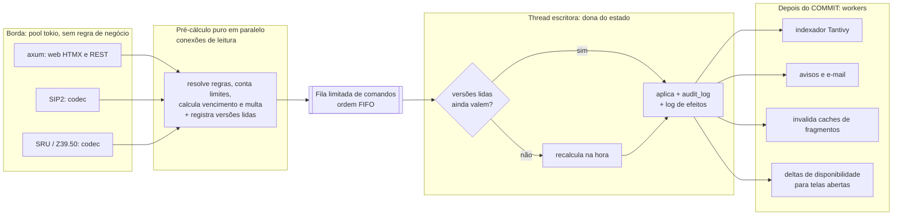
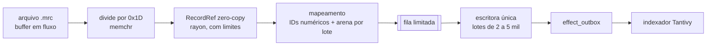
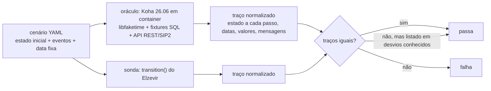
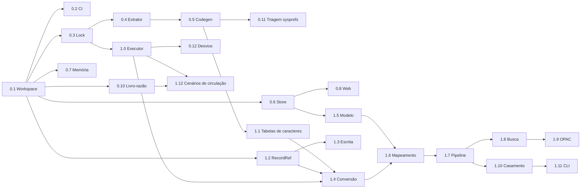

# Elzevir: estratégia de reconstrução inspirada no Horizon

> Status: proposta para discussão. Complementa [01](01-avaliacao-da-arquitetura.md) e [02](02-modo-de-implementacao.md).
> Data: 2026-11-12. Referência funcional: Koha 26.06.00.052 (na época em `koha/`; agora Koha 26.05.05 em `reference/koha/`). Licença do Elzevir: GPL-3.0-or-later.
>
> **Atualização (2026-11-12):** a versão-alvo passa a ser a estável mais recente, **Koha 26.05.05** (a mesma da instância de testes), e o código de referência vai para `reference/`, fora do workspace Cargo. As citações de arquivos abaixo foram verificadas no 26.06 e serão reconferidas na troca. A leitura MARC passou a ser por *buffer* em fluxo (§2.2 item 1), a Fase 0 ficou mais enxuta (§4) e o idioma principal é o inglês. Decisões consolidadas em [04-decisoes.md](04-decisoes.md).

O **Horizon** ([horizon-rust/horizon](https://github.com/horizon-rust/horizon)) é uma reimplementação do Minecraft: Java Edition 26.3 em Rust, sem nada de Java no programa final, publicada sob MIT por Ludovic Marie e colaboradores. É o caso mais próximo do Elzevir que existe hoje: um sistema grande e legado, reconstruído em Rust **por comportamento** (não por tradução de código), com a paridade **medida** contra o original. Em novembro de 2026 o projeto declara 326 *harnesses* de paridade, cada um rodando o jogo original e o Horizon com as mesmas entradas e comparando as saídas, e 0 lacunas visíveis ao jogador abertas de 833 encontradas.

Este estudo foi feito lendo a documentação de engenharia do próprio repositório (fontes no fim). Para cada técnica: **o que o Horizon faz**, com referência, e **como o Elzevir aplica**. Quando algo é inferência minha, está dito.

## Sumário

- [0. O Horizon em uma página](#0-o-horizon-em-uma-página)
- [1. Arquitetura e concorrência](#1-arquitetura-e-concorrência)
- [2. Memória, estruturas compactas e zero-copy](#2-memória-estruturas-compactas-e-zero-copy)
- [3. Reconstrução funcional: Koha 26.06 → Elzevir](#3-reconstrução-funcional-koha-2606--elzevir)
- [4. Plano acionável: Fases 0 e 1](#4-plano-acionável-fases-0-e-1)
- [5. O que **não** copiar do Horizon](#5-o-que-não-copiar-do-horizon)
- [Fontes](#fontes)

---

## 0. O Horizon em uma página

| Princípio do Horizon | Onde está documentado | Equivalente no Elzevir |
|---|---|---|
| **Versão-alvo fixada.** O comportamento-alvo é o Minecraft 26.3, fixado em `research-lock.json` (sha1 dos jars) e em um `version.rs` gerado. | `docs/rust-parity.md`, `docs/version-ports.md` | Koha **26.05.05** (estável mais recente) fixado num `koha-lock.json` e num `koha_version.rs` gerado |
| **O original é o oráculo.** Cada *harness* roda um oráculo Java sobre os jars reais e uma sonda Rust sobre as mesmas entradas, e compara. "Um *harness* é a especificação da sua área: nunca apague um." | `docs/rust-parity.md`, `docs/parity-workflow.md` | Koha real em container como oráculo; cada cenário diferencial é a spec do comportamento |
| **Paridade é o que o usuário observa, não as entranhas.** Desempenho pode mudar a ordem interna, desde que ninguém consiga notar; quem muda algo observável põe atrás de uma configuração e documenta. | `CONTRIBUTING.md`, "When it doesn't have to be 1:1" | Datas, valores, filas e mensagens iguais ao Koha; estrutura interna livre |
| **Livro-razão de portabilidade.** `tools/port_ledger.py` lista cada método do original ao lado da função Rust que o porta, nos dois sentidos, e mostra as lacunas. | `docs/port-ledger.md` | Livro-razão Koha → Elzevir sobre as ~6.000 *subs* Perl de `C4/` e `Koha/` |
| **Dados gerados, lógica reescrita.** Geradores produzem tabelas Rust versionadas (IDs de pacotes, constantes de versão) a partir de relatórios do original; a lógica é escrita à mão e verificada pelos *harnesses*. | `docs/version-ports.md` | Extrator do Koha + codegen; regras de circulação, reservas e multas reescritas |
| **Camadas com regra de dependência verificada no CI.** Motor (só o comportamento do original), plataforma (pontos de extensão) e produto (extras). | `docs/layers.md` | Núcleo de paridade com o Koha, plataforma, extras do Elzevir |
| **Uma só base de código para todos os papéis.** Servidor integrado e dedicado são o mesmo código, escolhido por um `ExecutionRole`. | `docs/server-levels.md` | Um binário: servidor web, importação, tarefas e SIP2 sobre o mesmo núcleo |
| **Medir antes de afirmar.** Benchmarks contra o original e contra o concorrente (Pumpkin), com metodologia publicada; contadores de alocação e censo de heap embutidos. | `docs/benchmark.md`, `docs/memory.md`, `docs/server-next.md` | Benchmarks contra o Koha, metas de memória e de alocação no CI |

---

## 1. Arquitetura e concorrência

### 1.1 O que o Horizon faz

**Um dono do estado, uma ordem fixa.** O estado do jogo vive numa estrutura `Game`, avançada pelo *tick* em uma ordem fixa, a mesma do original: tempo e clima, ticks agendados, raids, chunks, eventos de bloco, entidades em ordem de lista, *block entities* em ordem de lista (`docs/server-next.md` §4). Não há travas espalhadas pelo estado: há um dono.

**Paralelismo só onde não muda o resultado** (`docs/server-next.md` §4.2, modo padrão `tick = "vanilla"`):

1. **Trabalho puro adiantado em paralelo, confirmado em ordem.** Pathfinding e sensores rodam em todos os núcleos sobre uma *foto somente leitura* do mundo. O laço serial usa cada resultado se nada do que ele leu mudou desde então, conferindo um **contador de mudanças por seção**; se mudou, recalcula na hora.
2. **Trabalho de rede depois do tick.** Rastreamento de entidades, envio de chunks e codificação de pacotes leem o estado já avançado e rodam em paralelo por jogador, enquanto o próximo tick começa.
3. **Efeitos entre níveis num log ordenado.** No modo de níveis em paralelo (§4.1), cada nível grava os efeitos que cruzam fronteiras num **log ordenado**, aplicado numa barreira, na ordem do original.

**Rede fora da thread principal** (`docs/server-next.md` §5): um *pool* fixo de threads de I/O (`mio`, `epoll`/`kqueue`), **uma fila limitada por jogador** (passou do limite, desconecta) e a thread principal só empurra corpos de pacote. Pacotes de chunk são **comprimidos uma vez e compartilhados por todos os jogadores** (`SharedFrames`, com hash XXH3-128), e o pacote pronto de um chunk fica em cache **até um bloco dele mudar**. O rastreamento de entidades passa a ser um **log de mudanças (deltas)**, em vez de reconstruir o estado inteiro a cada tick.

**Salvamento fora da thread principal** (§5.5): o chunk é fotografado na thread principal (cópia barata) e os *workers* serializam, comprimem e gravam.

**Exatidão verificada, não presumida** (§4.3): cada fase paralela tem um interruptor que a roda em série (`HORIZON_SERIAL_TICK=entities,hub,...`). Um *harness* roda o mesmo cenário dos dois jeitos e compara um **digest do estado** a cada tick. Fase que não passa nessa comparação não entra no modo padrão. O modo mais rápido e não idêntico (`tick = "regions"`) existe, mas é **opt-in** e documentado como tal.

**Um código, vários papéis** (`docs/server-levels.md`): servidor integrado e dedicado executam o mesmo código; um `ExecutionRole` escolhido antes da construção decide o que liga.

**Separação protocolo × regras:** `horizon-protocol` contém só codecs, framing, criptografia e pacotes; as regras ficam em `horizon-world` (comportamento sem laço de jogo) e no `Game`. Os IDs de pacotes são **gerados** (`crates/horizon-protocol/src/ids.rs`, de `packets.json` do original).

### 1.2 Como o Elzevir aplica

O paralelo é direto: o **tick** do Horizon é a **thread escritora única** do Elzevir, e o `Game` é o banco SQLite com a conexão de escrita.



1. **Dono único do estado mutável.** Só a thread escritora escreve. Não há `Mutex` em volta de entidades de domínio: há **mensagens** (`Checkout`, `Checkin`, `PlaceHold`, ...) numa fila `mpsc` limitada, processadas em ordem de chegada. A ordem de chegada é registrada no `audit_log`, e reaplicar o log em outra base dá o mesmo estado. É a nossa "ordem fixa do tick".
2. **Pré-cálculo puro adiantado, confirmado em ordem** (o padrão de pathfinding do Horizon). No handler HTTP, numa conexão de **leitura**, o Elzevir já resolve as regras de circulação, conta empréstimos, calcula vencimento e multa, e anota **as versões das linhas que leu** (`patron.row_version`, `item.row_version`, versão das regras e do calendário). A escritora só confere essas versões (uma comparação de inteiros) e, se mudaram, recalcula ali mesmo. O tempo da escritora por empréstimo cai para "conferir + gravar". Isso é *optimistic concurrency* sem travas.
3. **Log de efeitos aplicado depois do COMMIT** (a barreira do Horizon). Indexação, avisos, e-mail, respostas de protocolo e invalidação de cache são gravados como linhas de `effect_outbox` **na mesma transação** e executados por *workers* após o commit. Nenhuma rede ou disco lento dentro da transação.
4. **Frames compartilhados → fragmentos compartilhados.** O HTML do registro no OPAC, a lista de exemplares e o MARC/BIBFRAME exportado de um registro são gerados **uma vez por versão do registro**, guardados em cache com chave `(registro, versão)` e invalidados quando o registro muda, como o pacote de chunk. Mil usuários vendo o mesmo livro custam uma renderização.
5. **Rastreamento por deltas → disponibilidade por deltas.** Cada mudança de status de exemplar gera um delta (`item 123: Disponível → Emprestado`). Telas abertas (balcão, OPAC) recebem os deltas por SSE e o HTMX troca só aquele trecho. Ninguém reconsulta a página inteira.
6. **Fila limitada por cliente.** Conexões SIP2 e SSE têm fila de saída com limite; um terminal travado não segura a escritora nem enche a memória (o Horizon desconecta quem passa do limite; o Elzevir faz o mesmo).
7. **Salvamento fotografado.** Backup com `VACUUM INTO` (foto consistente) ou Litestream, sempre em *worker*, nunca na escritora.
8. **Exatidão verificada.** A importação em lote e o indexador têm o interruptor `ELZEVIR_SERIAL=import,index`. Um teste roda o mesmo lote em série e em paralelo e compara um **digest do banco** (hash das tabelas normalizadas) e do conjunto de documentos indexados. Se os digests divergem, o paralelismo não entra.
9. **Exato por padrão, mais rápido por opção.** Onde o Elzevir puder ser mais rápido, mas com resultado observável diferente do Koha (por exemplo, um algoritmo de fila de reservas mais justo), isso vai atrás de uma configuração desligada por padrão e de um verbete em `docs/desvios-conhecidos.md`.
10. **Um binário, vários papéis.** `elzevir serve`, `elzevir import`, `elzevir worker` e o servidor SIP2 usam o mesmo `elzevir-app`; um `Role` decide o que liga (por exemplo, `import` não sobe HTTP). Importar pela CLI e pela tela é o mesmo código.
11. **Protocolo é só codec.** `elzevir-sip2` e `elzevir-sru` só traduzem mensagens para comandos e erros de domínio para respostas; as tabelas de campos SIP2 são geradas (§3.2), como os IDs de pacotes do Horizon.

---

## 2. Memória, estruturas compactas e zero-copy

### 2.1 O que o Horizon faz

- **Alocador global mimalloc** e, numa *feature* opcional `alloc-count`, **contadores de alocação por thread sem operações atômicas** (cada thread escreve só no próprio slot): custo medido de 0,9 a 2,3 ns por alocação, indistinguível de ruído no jogo. Outra *feature*, `alloc-census`, marca cada bloco com uma **etiqueta** e mostra o heap vivo por etiqueta (`docs/memory.md`).
- **Introspecção de memória em JSON** (`horizon-ctl memory`): cada estrutura grande soma os próprios bytes (chunks, entidades, filas por jogador, caches, fila de envio) e o que sobra aparece como "não atribuído".
- **Identidades numéricas em vez de nomes.** O registro de estados de bloco importa do original **as identidades e os padrões** (35.723 estados), não as implementações; seções residentes guardam **IDs numéricos** através de um registro compartilhado e emprestado (`docs/world-data.md`).
- **Paletas e seções uniformes.** Uma seção com um único valor **não tem array**; mudanças reaproveitam slots da paleta sem reempacotar tudo; a largura só muda quando precisa (`docs/world-data.md`). Seções iguais são **compartilhadas** entre cliente e servidor (`docs/memory.md`, `shared_with_server`).
- **Limites explícitos nos parsers.** O NBT tem teto padrão de 64 MiB, 1 milhão de nós e 512 níveis de aninhamento (`docs/world-data.md`): entrada hostil não derruba o processo.
- **Arquivo de dados mapeado, decodificado no primeiro uso** (`docs/server-next.md` §7.3): um `server.pack` binário e versionado é mapeado em memória e cada entrada só é decodificada quando usada pela primeira vez. Páginas que ninguém lê não contam na memória. Meta declarada: menos de 32 MB ocioso e partida em menos de 0,1 s.
- **Nada carregado enquanto ninguém usa; devolver memória depois** (§7.1, §7.5, §7.6): pools sobem com o primeiro jogador e encolhem depois do último; o bench confere que a memória volta abaixo da meta 60 s após a saída.
- **Gravação atômica de exportações**: arquivo temporário, `fsync` e publicação por *hard link* que falha se o destino existir (`docs/world-data.md`).

### 2.2 Como o Elzevir aplica no `elzevir-marc` e na importação



1. **Registro emprestado, nunca copiado.** O arquivo é lido em fluxo por um *buffer* reaproveitado, os registros são separados com `memchr` pelo terminador `0x1D`, e cada um vira um `RecordRef<'a>` que só guarda fatias do *buffer* (o empréstimo vale até o próximo registro). Mapear o arquivo com `memmap2` só entra se um benchmark mostrar ganho, e nesse caso num único bloco `unsafe` documentado dentro de `elzevir-marc`; as crates de domínio, aplicação e web mantêm `#![forbid(unsafe_code)]`:

   ```rust
   pub struct RecordRef<'a> { raw: &'a [u8], leader: &'a [u8; 24], dir: &'a [u8] }
   pub struct FieldRef<'a>  { tag: Tag, data: &'a [u8] }      // Tag = [u8; 3], nunca String
   impl<'a> FieldRef<'a> {
       pub fn subfields(&self) -> impl Iterator<Item = (u8, &'a [u8])> + 'a { /* divide por 0x1F */ }
       pub fn text(&self) -> Cow<'a, str> { /* emprestado se já for UTF-8 válido; aloca só para MARC-8/ISO 5426 */ }
   }
   ```

2. **Limites explícitos, como o NBT do Horizon.** Registro de até 99.999 bytes (limite do próprio ISO 2709), número máximo de campos e subcampos por registro, profundidade e tamanho máximos no MARCXML. Registro fora do limite vai para o relatório de erros do lote, sem derrubar a importação.
3. **Identidades numéricas.** Assim como o Horizon importa os 35.723 estados de bloco como identidades, o Elzevir importa do Koha **as identidades** dos vocabulários (códigos de idioma, tipos de material, tipos de item, termos de relator, categorias, bibliotecas) para registros gerados (§3.2) e guarda **IDs `u16`/`u32`** no modelo, não strings. Valores livres e muito repetidos (assuntos, nomes, editoras) são internados por lote e resolvidos para IDs de entidade com uma consulta por lote.
4. **"Seção uniforme sem array" → guardar só o que difere do padrão.** Configuração por biblioteca e por categoria guarda **apenas sobrescritas**; o resto vem do padrão (é o que o `horizon-server import` faz com o `server.properties`, descartando chaves no valor padrão). Exemplares guardam só os campos que diferem do padrão do seu tipo.
5. **Arena por lote e reaproveitamento.** As estruturas intermediárias do mapeamento de um lote vivem numa arena (`bumpalo`) zerada ao fim do lote, reaproveitada no seguinte. **Inferência minha:** o Horizon não documenta arenas no repositório público; a técnica vem do mesmo objetivo (zerar a rotatividade de alocação medida pelo `alloc-count`) e só entra se o contador mostrar o problema.
6. **Strings curtas sem heap.** Número de chamada, código de barras e ISBN em `compact_str`; listas pequenas (subcampos repetidos) em `smallvec`.
7. **Alocador e medição desde o primeiro dia.** mimalloc como alocador global; *feature* `alloc-count` com contadores por thread; métrica no CI: **alocações por registro** no caminho de leitura e mapeamento (meta inicial < 5) e **memória de pico constante** ao importar 1 milhão de registros.
8. **Introspecção.** `GET /admin/memory` (e `elzevir ctl memory`) devolve JSON com o tamanho de cada cache (fragmentos, regras resolvidas, calendário, leitor Tantivy), filas e pools, mais o resíduo "não atribuído", no mesmo formato do `horizon-ctl memory`.
9. **Dados gerados sem custo de partida.** As tabelas extraídas do Koha (frameworks MARC, MARC-8, ISO 5426, campos de busca) são compiladas como `static` no binário: zero tempo de carga e só as páginas usadas entram na memória. Meta: **partida < 100 ms** e **memória ociosa < 50 MB** com a base aberta.
10. **Ocioso de verdade.** O pool de importação, o indexador e as conexões SIP2 sobem sob demanda e encolhem depois.
11. **Exportação atômica.** Arquivos de exportação (MARC, BIBFRAME, backups) são gravados em temporário, sincronizados e publicados com *rename*/*hard link*, nunca sobrescritos pela metade.

### 2.3 Nas buscas de acervo

- **Um `IndexReader` compartilhado**, recarregado após cada commit, como o registro emprestado do Horizon. Nunca aberto por requisição.
- **Campos rápidos e armazenados** (título, autor, ano, capa) para montar a lista de resultados **sem ir ao SQLite por resultado**.
- **Disponibilidade numa consulta por página** (`WHERE instance_id IN (...)`), e atualizada por deltas nas telas abertas (§1.2, item 5).
- **Fragmento de resultado em cache por versão** (§1.2, item 4): a mesma busca popular, repetida, custa uma consulta ao índice e nenhuma renderização.
- **Esquema e extração de campos gerados** a partir de `admin/searchengine/elasticsearch/mappings.yaml` do Koha (156 campos bibliográficos): código compilado, não configuração interpretada a cada documento.

---

## 3. Reconstrução funcional: Koha 26.06 → Elzevir

### 3.1 Fixar o alvo, como o `research-lock.json`

- **`koha-lock.json`**: versão `26.05.05`, commit/tag de origem e SHA-256 dos arquivos extraídos.
- **`koha_version.rs` gerado** com as constantes da versão-alvo, conferido no CI (`--check`), como o `version.rs` do Horizon.
- **Atualizar de versão é um processo**, como o `version_port.py` do Horizon: rodar o extrator na nova versão do Koha, gerar o diff dos dados, rodar todos os cenários contra o novo oráculo e transformar as diferenças numa lista ordenada de tarefas. Não é reescrita.

### 3.2 Extrator e geradores: dados do Koha, lógica nossa

No Horizon, geradores em `tools/` produzem arquivos Rust versionados (`ids.rs`, `version.rs`, ordem de comandos) a partir de relatórios do original e de *exporters* Java que rodam contra o jar. O Elzevir faz o mesmo com o Koha. Como Koha e Elzevir são GPL-3.0-or-later, os dados extraídos **podem** ser versionados (o Horizon não pode versionar dados da Mojang; nós podemos).

| Fonte no Koha 26.06 (verificado neste repositório) | Gerado no Elzevir |
|---|---|
| `installer/data/mysql/en/marcflavour/marc21/mandatory/*.yml` (~120 mil linhas) e `.../unimarc/mandatory/*.yml` (~69 mil linhas) | Tabelas `static` de tags e subcampos MARC21 e UNIMARC (bibliográfico e autoridades) |
| `C4/Charset.pm`, tabela `%chars` (360 entradas) | Conversão ISO 5426 → Unicode |
| `codetables.xml` da Library of Congress (MARC-8; o Koha usa o módulo CPAN `MARC::Charset`, que não está no repositório) | Conversão MARC-8 → Unicode |
| `admin/searchengine/elasticsearch/mappings.yaml` | Esquema Tantivy e extração de campos de busca |
| `Koha/CirculationRules.pm`, `$RULE_KINDS` (57 tipos, cada um com escopo próprio, flag monetária e se pode ficar vazio) | Catálogo tipado de regras de circulação |
| `installer/data/mysql/mandatory/sysprefs.sql` (~935 padrões) + `koha-tmpl/.../admin/preferences/*.pref` (933 com tipo, opções e descrição) | **Inventário** para triagem e para o migrador, nunca configuração automática (§3.4) |
| `installer/data/mysql/mandatory/userpermissions.sql`, `userflags.sql` | Inventário de permissões para o RBAC |
| `installer/data/mysql/en/mandatory/*.yml` (tipos de débito/crédito, restrições, valores autorizados) | Vocabulários iniciais (identidades numéricas, §2.2 item 3) |
| `.../marc21/optional/marc21_default_matching_rules.yml` | Regras padrão de deduplicação |

Mecânica: um extrator em `tools/koha-extractor` lê YAML e SQL direto e, para estruturas que só existem em Perl (`$RULE_KINDS`, `%chars`), **executa o próprio Perl** para despejar JSON (o equivalente aos *exporters* Java do Horizon que rodam contra o jar). O JSON vai para `data/koha-26.06/` com um manifesto de SHA-256; `cargo xtask codegen` gera o Rust em `crates/elzevir-data/src/generated/`, versionado e conferido no CI com `--check`.

### 3.3 Livro-razão Koha → Elzevir (o `port_ledger` do Horizon)

O Horizon casa cada método do original com a função Rust que o porta, primeiro por uma **convenção de comentário** (`/// \`Classe.metodo\`: o que faz`) e depois por heurísticas (mesmo nome, mesmas constantes raras, mesmos IDs), e mostra cobertura e lacunas por pacote.

No Elzevir:

- **Convenção:** toda função que reconstrói um comportamento do Koha abre o comentário com a origem.

  ```rust
  /// Koha: `C4::Circulation::CalcDateDue`. Calcula o vencimento a partir das regras e do calendário da unidade.
  pub fn due_date(rules: &LoanRules, cal: &Calendar, now: Zoned) -> Result<Zoned, DueDateError> { ... }
  ```

- **`tools/koha_ledger`** indexa as ~6.000 *subs* de `C4/` e `Koha/` (pacote e nome são triviais de extrair do Perl) e as funções Rust com o comentário, e responde: `where C4::Circulation::AddIssue`, `what crates/elzevir-domain/src/circ.rs:120`, `coverage --module Circulation`, `gaps`.
- Categorias como as do Horizon: **portado**, **mapeado** (resolvido de outro jeito, com justificativa), **descartado** (não existe no Elzevir, com justificativa), **trivial** (acessor, sem comportamento), **pendente**.
- O relatório de cobertura por módulo vira o **painel de paridade** do README, com a escala do Horizon: 0, 0,25, 0,5, 0,75 e 1 por subsistema.

### 3.4 Mecanismos do Koha substituídos por equivalentes modernos

| Koha 26.06 | Problema | Elzevir | Técnica do Horizon que inspira |
|---|---|---|---|
| ~935 `systempreferences` globais, chave/valor em texto | Sem tipo, quase tudo global | **`elzevir.toml` tipado** + sobrescritas por unidade e categoria no banco, guardando só o que difere do padrão. `elzevir import-koha-prefs` lê a tabela do Koha: chaves com campo vão para a seção certa, chaves sem campo e fora do padrão vão para `[koha_legado]` para revisão, chaves no padrão são descartadas. Página "Para administradores do Koha: cada syspref ao lado do seu campo" | `server.toml` × `server.properties` e a página `owners.md` |
| `circulation_rules`: 57 tipos, valores em texto | Resolução repetida em vários lugares | Catálogo gerado + structs tipadas por escopo + **uma** função de resolução que explica de onde veio cada valor | Dados gerados, lógica reescrita |
| Estados codificados em letras e flags (`reserves.found`: `W`, `T`, `P`; `items.onloan`, `itemlost`, `withdrawn`, `damaged`, `notforloan`) | Estados impossíveis representáveis | **Máquinas de estado determinísticas** em Rust (`enum` + função de transição pura). Cada transição é testada contra o oráculo (§3.5) | "Retorne erros tipados onde o Java lança exceção" |
| Zebra / Elasticsearch | Serviço externo | **Tantivy embutido**, esquema gerado de `mappings.yaml` | Geradores a partir de dados do original |
| Template Toolkit + jQuery + DataTables | Telas pesadas | **Askama + HTMX**, fragmentos em cache por versão (§1.2) e deltas por SSE | `SharedFrames` e rastreamento por deltas |
| Avisos editáveis pela biblioteca (TT e a sintaxe `<<campo>>`) | Precisam ser editados em tempo de execução | **MiniJinja em sandbox**, com lista explícita de variáveis. O Askama compila os templates e não serve para texto editável | — |
| PDFs com `PDF::Reuse`/`PDF::API2` (etiquetas, carteirinhas) | Coordenadas fixas e manuais | **Typst** embutido, modelos `.typ` | — |
| `background_jobs` + RabbitMQ (STOMP) e ~56 scripts de `misc/cronjobs` | Serviços e agendamento externos | **Fila em SQLite + agendador interno**, com tela de estado | Um binário, vários papéis |
| `userflags` (bitmask) + `user_permissions` | Difícil de auditar | **RBAC** (papéis × permissões × unidade) | — |
| Plack/Starman + Memcached | Vários processos e cache externo | **axum** num processo, caches internos medidos pela introspecção (§2.2 item 8) | `horizon-ctl memory` |
| `C4/SIP` com lógica própria | Regras duplicadas fora da circulação | **Codec SIP2** sobre os mesmos comandos (§1.2 item 11) | `horizon-protocol` separado das regras |
| Atualizações de banco do Koha (`installer/data/mysql/db_revs`, 662 arquivos de 21.06 a 26.06) | — | O migrador aceita **Koha 26.06**. Bases mais antigas são atualizadas antes **pelo próprio atualizador do Koha** (no container do oráculo) e só então migradas. Portar 662 revisões não compensa | O Horizon portou os *DataFixers* porque mundos antigos são o caso comum; aqui a ferramenta oficial já resolve |

### 3.5 Máquina de estados determinística testada contra o oráculo

O núcleo da circulação vira um conjunto pequeno de máquinas de estado puras:

```rust
pub enum ItemState {
    Available,
    OnLoan   { loan: LoanId, due: Zoned },
    OnHold   { hold: HoldId, pickup: BranchId, expires: Date },   // Koha: reserves.found = 'W'
    InTransit{ from: BranchId, to: BranchId, reason: TransferReason }, // Koha: 'T' / branchtransfers
    Processing { hold: HoldId },                                  // Koha: 'P'
    Lost { since: Date, kind: LostKind },
    Withdrawn,
    NotForLoan(NotForLoanReason),
}

pub enum CircEvent { Checkout{..}, Checkin{..}, Renew{..}, HoldPlaced{..}, HoldFilled{..}, MarkLost{..}, ... }

/// Pura: sem I/O, sem relógio, sem aleatoriedade. Mesmo estado + mesmo evento = mesmo resultado.
pub fn transition(state: &ItemState, event: &CircEvent, ctx: &CircContext) -> Result<Transition, Refusal>;
```

Regras de portabilidade, no espírito das "regras que todo port mantém" do Horizon (que imita a aritmética exata do `Math` do Java e a ordem de sorteios do `Random`):

- **Aritmética de datas idêntica à do Koha:** fuso da instalação, unidades de empréstimo em dias **e** horas, os modos de calendário do Koha (`useDaysMode`, padrão `Calendar`), arredondamentos de fim de dia.
- **Dinheiro idêntico:** centavos inteiros, com as mesmas regras de arredondamento e teto das multas do Koha.
- **Ordens observáveis idênticas:** ordem da fila de reservas, ordem de listas exibidas (a ordenação do Koha depende do *collation* do MySQL; o Elzevir reproduz a mesma ordenação onde ela é visível).
- **Erros tipados onde o Koha só nega:** cada recusa tem uma variante (`Refusal::TooMany`, `Refusal::DebtOverLimit`, ...), mapeada para a mesma mensagem e o mesmo código SIP2 que o Koha produz.

Verificação, como os *harnesses* do Horizon:



Técnicas do `docs/parity-workflow.md` aplicadas:

- **Oráculo gravado e reaproveitado.** O Horizon tem um *shim* que grava cada execução do oráculo Java e a reaproveita enquanto as entradas não mudam: depois de uma mudança só em Rust, um *harness* cai de 53 s para 5 s. No Elzevir, as saídas do Koha ficam gravadas por hash do cenário em `conformance/koha-26.06/`; o CI comum compara contra as gravações, sem subir o Koha. Um job noturno, ou `--fresh`, regrava.
- **Rodar só o que a mudança afeta.** O Horizon registra de quais arquivos cada *harness* dependeu e só reroda os afetados. No Elzevir, cada cenário declara o módulo (`circ`, `holds`, `fines`, `calendar`) e o CI cruza com os arquivos alterados.
- **Detector de instabilidade.** Cenário novo ou alterado precisa passar 3 vezes seguidas antes do merge, como o *gate* do Horizon.
- **Testes do Koha como fonte.** `t/db_dependent/Circulation/*.t` (por exemplo `CalcDateDue.t`, `CalcFine.t`, `TooMany.t`, `Returns.t`), `Holds*.t` e `HoldsQueue*.t` viram cenários YAML.
- **Gravação de protocolo real.** Um proxy SIP2 entre um terminal de autoatendimento e o Koha grava sessões reais, que são reproduzidas contra o Elzevir e comparadas campo a campo.
- **Nunca apagar um cenário.** Como no Horizon, o cenário é a especificação; ele só muda junto com um verbete em `docs/desvios-conhecidos.md`.

### 3.6 Camadas, verificadas no CI

O Horizon separa **motor** (só o comportamento do original), **plataforma** (pontos de extensão) e **Horizon** (extras do produto), e um script lê `cargo metadata` e falha o CI se uma crate depender de uma camada que não pode.

| Camada no Elzevir | Conteúdo | Pode depender de |
|---|---|---|
| **Núcleo** | Paridade com o Koha: catálogo, circulação, reservas, multas, calendário, MARC, busca | núcleo |
| **Plataforma** | Configuração tipada, RBAC, i18n, temas, *hooks* e registros de extensão, introspecção | núcleo, plataforma |
| **Elzevir** | O que o Koha não tem: ferramentas LGPD, Typst, painéis, assistente de migração, deltas em tempo real, futuros plugins | plataforma, Elzevir |
| **Ferramentas** | Extrator, codegen, livro-razão, executor de cenários | qualquer uma; nada que vai para produção depende delas |

Extras que mudam algo observável em relação ao Koha começam **desligados**, como os extras do Horizon. Também do Horizon: o limite de tamanho de arquivo (um arquivo Rust acima de 3.000 linhas não pode crescer; o `game.rs` deles chegou a ~21.700 linhas e deixa a compilação incremental lenta).

---

## 4. Plano acionável: Fases 0 e 1

Substitui as listas do doc 02, §8. Cada tarefa traz a técnica do Horizon que aplica e o critério de pronto.

Prioridade da Fase 0: workspace, CI, `elzevir-store` e `elzevir-marc` primeiro. O ferramental do método (extrator, livro-razão, executor) começa mínimo para não engolir a fase; o executor de cenários abre a Fase 1.

### Fase 0: fundações

| # | Tarefa | Técnica (seção) | Pronto quando |
|---|---|---|---|
| 0.1 | Workspace: `elzevir-domain`, `elzevir-data`, `elzevir-marc`, `elzevir-store`, `elzevir-app`, `elzevir-web`, `elzevir-sip2` (vazia), `elzevir` (bin) e `xtask`; `tools/layers.json` | Camadas (3.6) | `cargo build` verde; `xtask check-layers` falha numa dependência proibida de teste |
| 0.2 | CI: `fmt`, `clippy -D warnings`, `nextest`, `cargo-deny`, `check-layers`, limite de tamanho de arquivo, `codegen --check` | Camadas e geradores (3.2, 3.6) | CI verde na main |
| 0.3 | `koha-lock.json` + `koha_version.rs` gerado | Alvo fixado (3.1) | `--check` falha se o lock mudar sem regerar |
| 0.4 | `tools/koha-extractor` v0: só `$RULE_KINDS` (via Perl) | Extrator (3.2) | JSON + manifesto reproduzíveis (duas execuções, mesmo resultado) |
| 0.5 | `cargo xtask codegen` → `elzevir-data` com *features* por grupo | Geradores (3.2) | Tipos de regra de circulação acessíveis em Rust, com escopo de cada um; o resto das tabelas entra com o extrator completo (1.1) |
| 0.6 | `elzevir-store`: PRAGMAs, **thread escritora dona do estado**, fila limitada, pool de leitura, `row_version` nas tabelas, `audit_log`, `effect_outbox` | Dono único, pré-cálculo confirmado, log de efeitos (1.2) | Teste com 50 escritores concorrentes: zero `SQLITE_BUSY`, ordem do `audit_log` reproduz o estado |
| 0.7 | mimalloc + *feature* `alloc-count` + `GET /admin/memory` | Medição (2.2 itens 7 e 8) | JSON com caches e resíduo; custo do contador medido |
| 0.8 | `elzevir-web` + `elzevir-web-templates` (templates Askama numa crate própria, tempo de recompilação incremental medido no CI): axum, HTMX, Fluent (inglês primeiro), *tokens* de design, login Argon2id, RBAC inicial | Camadas (3.6) | Login e página inicial com teste Playwright |
| 0.9 | *(movida para 1.0)* | | |
| 0.10 | `tools/koha_ledger` v0: script pequeno que lista *subs* do Koha e comentários `/// Koha:` | Livro-razão (3.3) | Relatório de cobertura gerado |
| 0.11 | Triagem de sysprefs a partir do inventário + desenho do `elzevir.toml` | Configuração tipada (3.4) | Cada preferência com destino; ADR com a lista da v1 |
| 0.12 | `docs/desvios-conhecidos.md` com formato lido pelo executor | Exato por padrão (1.2 item 9) | Formato definido; o executor (1.0) aceita um desvio listado e rejeita um não listado |

### Fase 1: MARC, modelo bibliográfico e busca

| # | Tarefa | Técnica (seção) | Pronto quando |
|---|---|---|---|
| 1.0 | Executor de cenários v0: Koha 26.05.05 em container com `libfaketime`, formato YAML, gravação do oráculo por hash, comparação de traços | Oráculo (3.5) | Um cenário de vencimento simples passando dos dois lados; CI usa a gravação |
| 1.1 | Extrator completo: frameworks MARC21, `mappings.yaml`, inventário de sysprefs, permissões, vocabulários; MARC-8 (LC `codetables.xml`), ISO 5426 (`%chars`), frameworks UNIMARC | Extrator (3.2) | Ida e volta caractere a caractere sobre as tabelas inteiras |
| 1.2 | `elzevir-marc`: `RecordRef`/`FieldRef` sobre *buffer* em fluxo (mmap só se o benchmark justificar), `memchr`, `simdutf8`, **limites explícitos** | Zero-copy e limites (2.2 itens 1 e 2) | 1 milhão de registros lidos com memória constante; fuzzing de 1 h sem falhas |
| 1.3 | Escrita ISO 2709 e MARCXML com publicação atômica | Exportação atômica (2.2 item 11) | Ida e volta byte a byte em registros válidos |
| 1.4 | Conversão MARC-8 / ISO 5426 → UTF-8 com `Cow` | Zero-copy (2.2 item 1) | Mesmo resultado que o Koha num corpus de registros legados (cenário diferencial) |
| 1.5 | Modelo inspirado em BIBFRAME com **identidades numéricas** para vocabulários | Identidades (2.2 item 3) | Repositórios e migrações testados |
| 1.6 | Mapeamento MARC21 → modelo, arena por lote, interning por lote | Arena e interning (2.2 itens 3 e 5) | Snapshots `insta` de 200 registros; exportação sem edição devolve o MARC original |
| 1.7 | Pipeline de importação: `rayon` → fila limitada → escritora → `effect_outbox`, com `ELZEVIR_SERIAL=import` | Pré-cálculo paralelo, confirmação serial, digest (1.2 itens 2, 3 e 8) | Digest igual em série e em paralelo; > 2.000 registros/s; < 5 alocações por registro |
| 1.8 | Tantivy: esquema e extração gerados, `IndexReader` compartilhado, indexador lendo a outbox, `ELZEVIR_SERIAL=index` | Geradores, dono único, digest (2.3, 1.2) | Mesmo conjunto de documentos em série e em paralelo; 50 consultas de referência comparadas com o Koha |
| 1.9 | OPAC mínimo: busca e registro com **fragmentos em cache por versão** e disponibilidade numa consulta por página | Frames compartilhados (1.2 item 4, 2.3) | p95 < 50 ms na busca e < 30 ms no registro, sobre 1 milhão de registros |
| 1.10 | Regras de casamento padrão do Koha | Extrator (3.2) | Reimportar o mesmo arquivo não duplica |
| 1.11 | CLI `elzevir import` / `export` como papel do mesmo binário | Um binário, vários papéis (1.2 item 10) | Importação do corpus da LC e de uma base exportada de um Koha |
| 1.12 | Primeiros cenários de circulação convertidos de `CalcDateDue.t` e `CalcFine.t`, rodando contra `transition()` pura (sem tela ainda) | Máquina de estados + oráculo (3.5) | Cenários passando; livro-razão mostra `CalcDateDue` e `CalcFine` como portados |

A tarefa 1.12 adianta um pedaço da Fase 3 de propósito: ela valida, cedo e de ponta a ponta, o ciclo cenário → oráculo → sonda → livro-razão, que é o coração do método.

### Fase 2: catálogo e busca (Onda 1)

> Status: **proposta** (2026-11-13), aguardando aprovação de Paulo. Escopo do doc 01, §5.2 (Tantivy, outbox, OPAC, editor de catalogação, autoridades básicas), com a interface da Onda 1 de [`UI_BIBFRAME_INTERACTION_SPEC.md`](../UI_BIBFRAME_INTERACTION_SPEC.md), §14. Tantivy, outbox e OPAC mínimo já vieram na Fase 1 (1.7 a 1.9); a Fase 2 é sobretudo a catalogação na equipe.

| # | Tarefa | Base | Pronto quando |
|---|---|---|---|
| 2.0 | Fixture de ida e volta com `952` repetido, `082`/`090` e acentos, exportada da equipe do oráculo com leitor fictício | Visão B.4 | Importar → exportar igual byte a byte; editar um campo mapeado muda só ele |
| 2.1 | Lacunas do modelo usadas pelos perfis livro e periódico: notas (500, 505, 590), público-alvo (521), `instance_contributions`, `quarantined_at` | Spec de UI §10 | Migração 6, mapeamento MARC dos dois lados e teste de ida e volta para cada campo |
| 2.2 | Comandos `catalog.update_work` e `catalog.update_instance` com `row_version` (`CatalogRefusal::Stale`), `audit_log`, `effect_outbox` e permissão de catalogação | Spec de UI §9 | Editar e exportar: o MARC muda só nos campos editados; edição concorrente recusada |
| 2.3 | Onda 1a: listagem da equipe (linha-família só leitura, semáforo, busca e listagem na mesma tela) | Spec de UI §2, §8; 1.8, 1.9 | 1 milhão de registros: p95 < 50 ms por página no servidor |
| 2.4 | Onda 1a: foco 80/20, cordinhas, trilha, `Esc` e atalhos de teclado | Spec de UI §3, §13 | Navegação completa só por teclado; transição sem quadro perdido em Chrome e Firefox |
| 2.5 | Onda 1b: edição no lugar com perfis livro e periódico (um arquivo tipado por perfil) | Spec de UI §4; 2.1, 2.2 | Editar pela tela e exportar muda só os campos editados; edição pendente nunca é descartada em silêncio |
| 2.6 | Onda 1b: "+ Nova" e catalogação contínua (`catalog.add_instance`, `Ctrl+N`) | Spec de UI §6.1, §6.2 | Registro criado pela tela exporta MARC válido e entra no índice |
| 2.7 | Onda 1c: grade de exemplares `<elz-item-grid>` e `catalog.save_items` em lote | Spec de UI §5 | 50 exemplares bipados seguidos sem perder leitura; recusa por célula |
| 2.8 | Onda 1d: rascunho por ISBN da própria base | Spec de UI §6.3; 1.10 | ISBN bipado de livro já existente leva à grade dele |
| 2.9 | Onda 1e: autoridades básicas (`agent_identifiers`, `catalog.update_agent`, coluna de Autoridades, ligação por papel, aviso de alcance ao renomear) | Spec de UI §16 | Renomear um agente sobe o `row_version` das Instâncias ligadas e aparece no OPAC e no MARC exportado |

Fica para depois da Fase 2: Z39.50/SRU (Fase 4), estação de IA, circulação no muro (Fase 3) e a Onda 2 (mesclagem e quarentena pela tela).

### Ordem e trilha crítica



Trilha crítica: **lock → extrator → codegen → tabelas de caracteres → conversão → mapeamento → pipeline → busca → OPAC**. O executor de cenários (1.0, no início da Fase 1) e o livro-razão (0.10) correm em paralelo e precisam estar prontos antes de 1.4 e 1.12.

### Primeira semana depois do merge

1. PR 1: workspace, CI e `layers.json` (0.1, 0.2).
2. PR 2: `koha-lock.json`, `koha_version.rs` e o primeiro gerador, só com `$RULE_KINDS` (0.3, parte de 0.4 e 0.5): prova o pipeline extrator → JSON → Rust com o menor dado possível.
3. PR 3: `elzevir-store` com a escritora única, `row_version`, `audit_log` e `effect_outbox` (0.6).
4. PR 4: `elzevir-marc` lendo ISO 2709 com `RecordRef` sobre *buffer* em fluxo e limites, com fuzzing (1.2, puxada para a Fase 0 por prioridade).

PRs pequenos (até ~500 linhas, a regra do Horizon), cada um com o seu critério de pronto.

---

## 5. O que **não** copiar do Horizon

- **Código não revisado por pessoas.** O Horizon declara que a maior parte do código é escrita por agentes de IA e que nem toda linha é lida por uma pessoa; a garantia vem dos *harnesses*. O Elzevir lida com dados pessoais (LGPD) e dinheiro (multas): manter revisão humana nos módulos de leitores, contas e permissões, além dos cenários.
- **Arquivos gigantes.** O próprio Horizon tem regra para conter `game.rs` (~21.700 linhas). Começar com módulos pequenos.
- **Incidentes de licença.** O Horizon teve de remover código escrito a partir do código-fonte de outro projeto (o suporte a shader packs, depois refeito em *clean room* a partir de uma especificação) e reescrever funções traduzidas do OpenJDK. No Elzevir, ler o Koha é permitido (mesma licença), mas o processo de "spec antes do código" se mantém por qualidade; e qualquer referência de licença incompatível (por exemplo, documentação ou código de sistemas proprietários) entra só como descrição de comportamento, com registro de procedência, como no `docs/cleanroom/` deles.
- **Infraestrutura de escala que ainda não precisamos.** Execução distribuída de *harnesses* em várias máquinas e o painel de agentes resolvem o volume do Horizon (326 *harnesses*). Começamos com um executor local e gravações no CI.

---

## Fontes

Repositório [horizon-rust/horizon](https://github.com/horizon-rust/horizon), branch `main`, lido em 2026-11-12:

- [README.md](https://github.com/horizon-rust/horizon/blob/main/README.md): estado, desempenho, tabela de paridade por subsistema
- [AGENTS.md](https://github.com/horizon-rust/horizon/blob/main/AGENTS.md): mapa das crates, regras de teste, PRs pequenos
- [CONTRIBUTING.md](https://github.com/horizon-rust/horizon/blob/main/CONTRIBUTING.md): quando a paridade não precisa ser 1:1
- [docs/rust-parity.md](https://github.com/horizon-rust/horizon/blob/main/docs/rust-parity.md): versão fixada, *harnesses* como spec, regras de portabilidade
- [docs/parity-workflow.md](https://github.com/horizon-rust/horizon/blob/main/docs/parity-workflow.md): executor, reaproveitamento do oráculo, *gate*, detector de instabilidade
- [docs/port-ledger.md](https://github.com/horizon-rust/horizon/blob/main/docs/port-ledger.md): livro-razão método → função
- [docs/version-ports.md](https://github.com/horizon-rust/horizon/blob/main/docs/version-ports.md): fixação de versão, geradores, processo de atualização
- [docs/server-next.md](https://github.com/horizon-rust/horizon/blob/main/docs/server-next.md): ordem do tick, paralelismo exato, I/O, `SharedFrames`, deltas, memória e partida
- [docs/server-levels.md](https://github.com/horizon-rust/horizon/blob/main/docs/server-levels.md): níveis, `ExecutionRole`
- [docs/memory.md](https://github.com/horizon-rust/horizon/blob/main/docs/memory.md): mimalloc, `alloc-count`, censo de heap, introspecção
- [docs/world-data.md](https://github.com/horizon-rust/horizon/blob/main/docs/world-data.md): identidades numéricas, paletas, seções uniformes, limites do NBT, exportação atômica
- [docs/layers.md](https://github.com/horizon-rust/horizon/blob/main/docs/layers.md): camadas, regra de dependência, limite de tamanho de arquivo
- [docs/owners.md](https://github.com/horizon-rust/horizon/blob/main/docs/owners.md): `server.properties` → `server.toml`
- [docs/how-horizon-is-built.md](https://github.com/horizon-rust/horizon/blob/main/docs/how-horizon-is-built.md): processo, agentes de IA, incidentes de licença
- [docs/cleanroom/README.md](https://github.com/horizon-rust/horizon/blob/main/docs/cleanroom/README.md): processo de *clean room*

Library of Congress: [MARC-8 code tables](https://www.loc.gov/marc/specifications/codetables.xml). Koha: arquivos citados, verificados no 26.06 e agora em `reference/koha/` (26.05.05).
